# Pacagen B-roll library

**Product:** Cat allergen neutralizing spray + cat allergen reducing supplement + WhiskerBlock powder  
**Drive folders:** [folder 1](https://drive.google.com/drive/folders/1-7sQpKl0AAn6fOKnXBuczjWl4ajC3mjG) · [folder 2](https://drive.google.com/drive/folders/1Rzp2KmpcLtVEMqLZSZA92K9N5ShiA36Q) · [folder 3](https://drive.google.com/drive/folders/1dcrdbOeYrqY_jpALUPfBRYTECSPseL0h)  
**Clips:** 210 unique · 59 min 49 s total. Duplicates on Drive are merged (see `also_named` in catalog.json).  
**Audio:** room sound only, no talking. Mute it or use it as quiet ambience.

## Shoots: don't mix homes in one ad unless the script allows it

| Shoot | Clips | What |
|---|---|---|
| **A** | 56 | Home A: Siamese + Ragdoll, kitchen with granite counters (folder 'Pacagen B ROLL extras') |
| **B** | 148 | Home B: Tiger (brown tabby), Squirrel (silver tabby) and Salem (black cat); several creators (folder 2: SPRAY / SUPPLEMENT / CLEANING / GENERAL CAT) |
| **C** | 6 | Allergy-symptom shoot: creator in white tank, pills, sprays, brain fog (folder 3; the talking-head file is intentionally excluded) |

**Creators:** **A**: Home A creator: dark hair, green tee (one woman; 3 clips on 1 Nov in brown tee + jeans) · **B1**: Home B: long dark hair, blue crop top / navy velvet (sunny white bedroom, checkered entry) · **B2**: Home B + allergy shoot: long dark hair, white tank + brown capris or purple pajamas (stairs, laundry, cleaning) · **B3**: Home B: pink hoodie / tan hoodie, often with Salem or Tiger in bed (selfie style)

**Excluded:** `TALKING HEAD _ SCRIPT` (uploaded by mistake, not B-roll; user asked to skip)

> ⚠ **HDR (HLG) clips (37):** convert to Rec.709/SDR in your NLE or they look washed out next to SDR clips: `USE-02`, `USE-03`, `USE-04`, `CLEAN-05`, `CLEAN-10`, `BOND-06`, `BOND-08`, `BOND-09`, `BOND-12`, `BOND-13`, `BOND-17`, `BOND-18`, `BOND-19`, `BOND-22`, `BOND-23`, `BOND-24`, `BOND-25`, `HOME-02`, `HOME-04`, `HOME-05`, `HOME-06`, `HOME-08`, `HOME-11`, `HOME-12`, `HOME-14`, `HOME-15`, `HOME-17`, `HOME-19`, `HOME-22`, `HOME-23`, `HOME-26`, `HOME-27`, `HOME-29`, `HOME-30`, `HOME-33`, `HOME-34`, `HOME-38`

> ⚠ **Not standard 4K vertical:** `USE-20` (1948x3462), `FEED-05` (720x1280), `BOND-07` (1806x3212), `BOND-09` (1634x2906), `BOND-10` (3840x2160), `BOND-14` (2040x3626), `BOND-25` (1876x3336), `HOME-15` (1080x1920), `HOME-33` (1080x1920). Most are slightly cropped vertical; `BOND-10` is landscape.

**Get files:** `python3 broll-library/fetch.py pacagen --id SUP-11` · `--tag hook` · `--category supplement` · `--shoot B` · `--cat salem`

---

## Story map: which clip for which beat

| Ad beat | Clips (A/B/C = shoot) |
|---|---|
| **Hook / scroll-stopper** | A: RAG-01, FEED-06, PROB-01, RAG-02 · B: HOME-30 (Tiger 'king'), HOME-38 (Tiger in tie), HOME-17 (Squirrel bow tie), PRD-15 (creator holds box up), MED-01 (brain fog) |
| **Problem: hair everywhere** | A: PROB-01, PROB-02, PROB-03 |
| **Problem: allergy symptoms / meds** | C: MED-01 brain fog, MED-05 annoyed taking pills, MED-06 dry mouth, MED-02/03 pills, MED-04 nasal sprays · A: FEED-03 @0:13 nose-rub |
| **What I tried before** | B: CLEAN-01/02/06 air purifiers, CLEAN-03/04/05 laundry, CLEAN-07 to 10 sweeping/vacuuming · A: AIR-01 to 03, PROB-02 |
| **Problem: cat shut out** | A: DOOR-01, DOOR-03, DOOR-02 |
| **Product reveal / unboxing** | B: PRD-20 unboxing, PRD-13/14 boxes, PRD-16 logo, PRD-11 bottle → cat reveal · A: PRD-01, PRD-03 |
| **How it works: Step 1 Activate** | B: PREP-02 powder → PREP-01 solution → PREP-03 trigger → PREP-04 shake · A: PRD-08 |
| **How it works: Step 2 Neutralize (spray)** | B: USE-22 / USE-11 hero mist, USE-07, USE-19 bed, USE-13 couch, USE-08 entry rug, USE-20 stairs, USE-18 scratcher · A: USE-01, USE-02 |
| **How it works: 3-step card** | B: PRD-12 · A: PRD-06 |
| **Supplement demo** | B: SUP-08 open jar → SUP-15 scoop → SUP-11 sprinkle on food → SUP-03/04 hero with cat · A: PRD-04, FEED-01 |
| **'They love it' (palatability)** | B: FEED-26 licking plate, FEED-24 eating leftovers, FEED-18 empty plates, FEED-23 finishing |
| **Pet-safe / cat-approved** | A: USE-06 · B: PRD-11, PRD-27 (product next to a sleeping cat) |
| **After / result** | B: BOND-16 reading in bed with cats, BOND-24 cuddling Tiger, BOND-23 petting Squirrel, BOND-18 walking with Salem, BOND-06 cat on chest · A: USE-05 @0:45, BOND-01 to 04 |
| **CTA / end card** | B: PRD-16 logo, PRD-28 tub push-in, PRD-13 both boxes · A: PRD-01, PRD-04 |
| **Funny beat** | B: HOME-13 Salem tongue out, HOME-12 belly-up, HOME-37 Tiger snoot, FEED-24 stealing leftovers · A: RAG-12, RAG-02 |
| **Filler / pacing** | B: HOME-* (38 clips) · A: SIA-*, RAG-* |

## Quick index

| ID | Shoot | Clip | Length | Cat |
|---|---|---|---|---|
| `PRD-01` | A | Full lineup on counter — slow push-in | 6.3s | none |
| `PRD-02` | A | Full lineup on counter — slide left→right | 3.4s | none |
| `PRD-03` | A | Creator unboxes / presents each product | 21.9s | none |
| `PRD-04` | A | Supplement tub in hand — rotate to logo | 9.2s | none |
| `PRD-05` | A | Supplement tub back label | 3.4s | none |
| `PRD-06` | A | Spray box back — 3-step instructions | 3.8s | none |
| `PRD-07` | A | Dark-blue box back — 'Inside this pack' | 2.0s | none |
| `PRD-08` | A | WhiskerBlock powder stick in hand | 8.0s | none |
| `PRD-09` | B | Spray bottle tossed/placed on bathroom counter (green tile) | 16.2s | none |
| `PRD-10` | B | Spray bottle turned in hands, sunny window | 30.4s | none |
| `PRD-11` | B | Hand holds spray bottle, pulls away to reveal tabby (Tiger) sleeping on fluffy bed | 13.9s | tiger |
| `PRD-12` | B | Spray box rotated: front, side, back 3-step instructions | 12.3s | none |
| `PRD-13` | B | Two spray boxes (single pack + blue twin pack) on marble | 8.7s | none |
| `PRD-14` | B | Blue twin-pack box lifted, rotated to logo top | 8.5s | none |
| `PRD-15` | B | Creator B1 (blue top, red lips) holds spray box by face, points at it | 12.0s | none |
| `PRD-16` | B | Pacagen logo on box top close-up | 10.4s | none |
| `PRD-17` | B | Hand picks up spray bottle in bathroom, label to camera | 14.1s | none |
| `PRD-18` | B | Hand lifts spray bottle into frame, bedroom background | 14.1s | none |
| `PRD-19` | B | Spray bottle over striped bedding, push in to label | 10.6s | none |
| `PRD-20` | B | Unboxing spray kit: box opened, pouch + bottle pulled out | 45.4s | none |
| `PRD-21` | B | Supplement tub back label rotated in hand, white bg | 12.4s | none |
| `PRD-22` | B | Supplement tub rotated in hand, white bg, logo lid | 8.7s | none |
| `PRD-23` | B | Supplement tub rotated in hand, couch/tile bg | 27.1s | none |
| `PRD-24` | B | Supplement tub placed on bathroom counter | 15.4s | none |
| `PRD-25` | B | Supplement tub in hand over dining table, rotate to lid logo | 9.1s | none |
| `PRD-26` | B | Supplement tub in hand in front of sunny bed | 10.3s | none |
| `PRD-27` | B | Supplement tub held in front of sleeping tabby on bed | 10.6s | tiger |
| `PRD-28` | B | Supplement tub, lid ajar, slow push-in | 8.5s | none |
| `PREP-01` | B | Pouring stabilizing solution from pouch into spray bottle | 58.5s | none |
| `PREP-02` | B | Tearing WhiskerBlock powder stick and pouring into bottle | 33.9s | none |
| `PREP-03` | B | Screwing spray trigger onto bottle | 12.2s | none |
| `PREP-04` | B | Hand shakes spray bottle in front of plant | 24.3s | none |
| `PREP-05` | B | Unscrewing trigger, pouring/handling pouch next to bottle | 15.9s | none |
| `USE-01` | A | Spraying the cat tree | 10.7s | none |
| `USE-02` | A | Spraying the couch (sectional) | 6.2s | none |
| `USE-03` | A | Spraying the couch — leaning across | 4.4s | none |
| `USE-04` | A | Spraying cat climbing mats / play area | 5.0s | none |
| `USE-05` | A | Spray couch → sit and read WITH the cat (88s) | 87.8s | siamese |
| `USE-06` | A | Siamese sniffing the spray bottle on windowsill | 6.2s | siamese |
| `USE-07` | B | Creator B1 sprays bed, wide, sunlight | 10.8s | none |
| `USE-08` | B | Creator B1 sprays carpet runner on checkered entryway floor, mist in sunlight | 13.6s | none |
| `USE-09` | B | Hand sprays cat tree by window (arm only) | 7.7s | none |
| `USE-10` | B | Hand sprays cat tree bed close | 13.2s | none |
| `USE-11` | B | Spray mist close-up in front of door, backlit | 5.5s | none |
| `USE-12` | B | Creator B2 (white top) sprays coffee table area | 12.5s | none |
| `USE-13` | B | Creator B2 sprays grey couch | 16.9s | none |
| `USE-14` | B | Creator B2 sprays white desk chair | 6.2s | none |
| `USE-15` | B | Creator B2 sprays blue dining chairs | 8.6s | none |
| `USE-16` | B | Arm sprays pillows, sunlit bed | 9.4s | none |
| `USE-17` | B | Creator B1 sprays pillows/bed, wide | 15.1s | none |
| `USE-18` | B | Creator B2 sprays tall scratcher post | 8.5s | none |
| `USE-19` | B | Creator B1 sprays bed sheets, pulls sheets back | 22.8s | none |
| `USE-20` | B | Creator B2 sprays carpeted stairs walking down | 40.3s | none |
| `USE-21` | B | Creator B2 sprays bar stools at kitchen island | 17.4s | none |
| `USE-22` | B | Spray mist backlit in sunlight over bed — hero mist shot | 15.5s | none |
| `SUP-01` | B | Sprinkling supplement onto food plate in hand | 15.1s | none |
| `SUP-02` | B | Sprinkling supplement on plate, alt | 12.8s | none |
| `SUP-03` | B | Hero: tabby eats from plate, supplement tub behind on counter | 5.9s | tiger |
| `SUP-04` | B | Hero: plates + supplement tub, cat head dips in | 3.9s | tiger |
| `SUP-05` | B | Hand holds supplement jar in front of cats eating | 7.8s | multiple |
| `SUP-06` | B | Hand holds open jar showing powder, cats eating behind | 12.8s | multiple |
| `SUP-07` | B | Opening supplement jar on counter, scoop out powder | 19.2s | none |
| `SUP-08` | B | Opening supplement jar in hand, reveal powder | 26.9s | none |
| `SUP-09` | B | Placing empty steel plates then supplement tub on counter | 15.3s | none |
| `SUP-10` | B | Pouring food + scooping supplement on plates, cat sneaks in | 109.6s | tiger |
| `SUP-11` | B | Scooping supplement and sprinkling on food plate | 32.8s | none |
| `SUP-12` | B | Opening jar, lifting scoop out | 13.3s | none |
| `SUP-13` | B | Scoop held over open jar, lid beside | 18.1s | none |
| `SUP-14` | B | Scooping powder onto food plates on wooden floor | 79.8s | none |
| `SUP-15` | B | Scooping supplement in jar held in hand, scoop full shown | 55.1s | none |
| `SUP-16` | B | Tub placed on counter, then steel plate set beside | 11.9s | none |
| `SUP-17` | B | Tub set beside empty steel plate | 6.0s | none |
| `SUP-18` | B | Opening lid and pulling scoop out | 13.7s | none |
| `FEED-01` | A | Siamese eats from bowl next to supplement tub | 5.2s | siamese |
| `FEED-02` | A | Siamese eats next to tub — push-in | 7.2s | siamese |
| `FEED-03` | A | Creator sets out bowls — then rubs nose | 17.7s | none |
| `FEED-04` | A | Ragdoll eating at feeding tray | 4.7s | ragdoll |
| `FEED-05` | A | Ragdoll eating — wide, low-res | 5.8s | ragdoll |
| `FEED-06` | A | Ragdoll walks up to camera past food tray | 3.5s | ragdoll |
| `FEED-07` | A | Feeding station tray — slow pan | 3.0s | none |
| `FEED-08` | A | Kibble bowls + water fountain push-in | 2.9s | none |
| `FEED-09` | B | Two tabbies eating raw food from metal plates on wooden table, plant behind | 17.8s | multiple |
| `FEED-10` | B | Tabbies eating, push-in close | 15.2s | multiple |
| `FEED-11` | B | Tabbies eating, alt angle | 12.5s | multiple |
| `FEED-12` | B | Tiger + Squirrel eating side by side on table | 6.0s | tiger + squirrel |
| `FEED-13` | B | Two cats (black + tabby) eating from metal bowls on rug | 7.8s | multiple |
| `FEED-14` | B | Two cats eating on rug, handheld closer | 16.7s | multiple |
| `FEED-15` | B | Cats eating on rug with supplement tub placed beside bowl | 17.2s | multiple |
| `FEED-16` | B | Eating close-ups, tabby on rug | 46.9s | multiple |
| `FEED-17` | B | Two cats eating full plates on rug | 6.7s | multiple |
| `FEED-18` | B | Empty licked-clean plates on rug | 5.6s | none |
| `FEED-19` | B | Tabby eating raw food on wooden floor, close | 88.0s | tiger |
| `FEED-20` | B | Hand sets food plate on rug; Salem (black cat) walks in to eat | 18.2s | salem |
| `FEED-21` | B | Hand sets food plate down on empty rug | 13.3s | none |
| `FEED-22` | B | Set food down, then Squirrel/Tiger come eat | 30.9s | multiple |
| `FEED-23` | B | Squirrel + Tiger finishing their plates | 16.0s | squirrel + tiger |
| `FEED-24` | B | Squirrel eating Tiger's leftovers, close | 13.7s | squirrel |
| `FEED-25` | B | Squirrel eating leftovers, wide | 17.9s | squirrel |
| `FEED-26` | B | Squirrel licking plate clean | 12.6s | squirrel |
| `FEED-27` | B | Tiger (light tabby) eating close-up from glass plate | 32.2s | tiger |
| `PROB-01` | A | Picking cat hair out of cat bed | 7.3s | none |
| `PROB-02` | A | Lint-rolling cat hair off shirt | 13.6s | none |
| `PROB-03` | A | Brushing hair off shirt, waving it away | 8.2s | none |
| `MED-01` | C | Creator B2 at desk, foggy/confused, head in hand — '3pm brain fog' | 20.6s | none |
| `MED-02` | C | Hand holds Allergy Relief (cetirizine) pill box | 10.4s | none |
| `MED-03` | C | Hand holds allergy pill bottle | 4.6s | none |
| `MED-04` | C | Hand picks up nasal allergy sprays | 9.3s | none |
| `MED-05` | C | Creator B2 on stairs opening allergy pill box, annoyed | 21.9s | none |
| `MED-06` | C | Creator B2 sitting on stairs drinking water, dry mouth | 26.7s | none |
| `CLEAN-01` | B | Creator B2 turns on 2 air purifiers on counter | 20.8s | none |
| `CLEAN-02` | B | Creator B2 sets up air purifier by vacuum stand | 18.0s | none |
| `CLEAN-03` | B | Creator B2 loading top-load washer with sheets | 13.3s | none |
| `CLEAN-04` | B | Creator B2 moving laundry into dryer | 22.7s | none |
| `CLEAN-05` | B | Creator B2 (pajamas) unloading dryer, folding | 57.3s | none |
| `CLEAN-06` | B | Creator B2 turns on air purifier on dresser, walks to camera | 29.5s | none |
| `CLEAN-07` | B | Creator B2 sweeping floor, wipes forehead tired | 62.8s | none |
| `CLEAN-08` | B | Creator B2 sweeping bedroom floor by mirror | 84.7s | none |
| `CLEAN-09` | B | Creator B2 vacuuming office floor with cordless vac | 38.3s | none |
| `CLEAN-10` | B | Creator B2 (purple pajamas) vacuuming kitchen floor | 22.5s | none |
| `AIR-01` | A | Air purifier → pan up to Siamese on cat tree | 8.6s | siamese |
| `AIR-02` | A | Air purifier display push-in | 4.6s | none |
| `AIR-03` | A | Siamese on tree → pan down to air purifier | 6.2s | siamese |
| `DOOR-01` | A | Open door → Siamese sitting waiting outside | 4.4s | siamese |
| `DOOR-02` | A | Siamese walking outside door gap | 4.2s | siamese |
| `DOOR-03` | A | Door closing on Siamese | 5.1s | siamese |
| `BOND-01` | A | Petting ragdoll on bed | 10.7s | ragdoll |
| `BOND-02` | A | Scratching ragdoll's head | 11.9s | ragdoll |
| `BOND-03` | A | Belly rubs — ragdoll on back | 13.6s | ragdoll |
| `BOND-04` | A | Petting ragdoll — cat closes eyes | 14.9s | ragdoll |
| `BOND-05` | B | Creator B1 (navy velvet) sits on bed petting 2 tabbies | 25.3s | multiple |
| `BOND-06` | B | Creator B3 lying in bed with tabby on chest, sunlit | 45.3s | squirrel |
| `BOND-07` | B | Creator B3 lying in bed cuddling Squirrel, selfie | 8.6s | squirrel |
| `BOND-08` | B | Creator in pink hoodie sleeping/cuddling Tiger in bed | 55.6s | tiger |
| `BOND-09` | B | Creator cuddling Squirrel napping in bed, sunlit | 43.9s | squirrel |
| `BOND-10` | B | Creator on orange pumpkin-print bed holding Squirrel — LANDSCAPE 16:9 | 4.2s | squirrel |
| `BOND-11` | B | Creator reading on orange bed, cats around, waves | 12.3s | multiple |
| `BOND-12` | B | Squirrel kneading, hand pets back | 16.1s | squirrel |
| `BOND-13` | B | POV petting kneading tabby, legs in frame | 14.6s | squirrel |
| `BOND-14` | B | POV pets Squirrel on bed, cat walks over to lap | 20.4s | squirrel |
| `BOND-15` | B | POV petting Tiger sitting on lap/blanket | 20.6s | tiger |
| `BOND-16` | B | Creator reading in bed while Tiger + Salem lounge on bed | 97.4s | tiger + salem |
| `BOND-17` | B | Salem close-up being scratched on lap | 15.9s | salem |
| `BOND-18` | B | Creator B3 (pink hoodie) carries Salem walking on street, smiling | 16.1s | salem |
| `BOND-19` | B | Creator B3 holds Salem in pet carrier-hoodie, poses to camera | 54.1s | salem |
| `BOND-20` | B | Creator B3 sits on floral bed petting Salem, Salem rolls | 50.4s | salem |
| `BOND-21` | B | Creator B3 lies on bed petting Salem while Tiger lounges | 35.7s | salem + tiger |
| `BOND-22` | B | Tiger sleeping on carpet in sun, hand pets | 42.5s | tiger |
| `BOND-23` | B | Creator B3 (tan hoodie) lying on bed petting Squirrel | 55.0s | squirrel |
| `BOND-24` | B | Creator B3 (pink hoodie) lying in bed cuddling Tiger | 35.8s | tiger |
| `BOND-25` | B | Creator B3 selfie lying in bed with Tiger beside, smiling | 6.1s | tiger |
| `BOND-26` | B | Creator B3 leans over bed petting Tiger | 13.8s | tiger |
| `HOME-01` | B | Hand feeds lickable treat to Tiger + Salem on bed | 9.7s | tiger + salem |
| `HOME-02` | B | Squirrel + Tiger climbing cat tree | 40.4s | squirrel + tiger |
| `HOME-03` | B | Tabby grooming paw on bed | 16.1s | tiger |
| `HOME-04` | B | Squirrel kneading blanket (making biscuits), top-down | 7.2s | squirrel |
| `HOME-05` | B | Tabby in grey sweater on bed by plant | 11.2s | squirrel |
| `HOME-06` | B | Salem (black cat) rolling on floor, looks up, close | 7.3s | salem |
| `HOME-07` | B | Salem + Squirrel outside on patio chair/ground | 8.7s | salem + squirrel |
| `HOME-08` | B | Salem + Squirrel (in white shirt) in backyard dirt | 7.1s | salem + squirrel |
| `HOME-09` | B | Salem lying on floral bedsheets | 10.9s | salem |
| `HOME-10` | B | Salem lying on floral sheets, alt | 6.0s | salem |
| `HOME-11` | B | Salem lounging on couch back, push-in to sleepy face | 5.9s | salem |
| `HOME-12` | B | Salem sleeping belly-up on rug, top-down | 9.4s | salem |
| `HOME-13` | B | Salem sleeping in chair, extreme close-up, tongue out | 13.1s | salem |
| `HOME-14` | B | Squirrel rubbing on window post, close, sky behind | 8.1s | squirrel |
| `HOME-15` | B | Squirrel + Salem lying on carpet near door | 9.1s | squirrel + salem |
| `HOME-16` | B | Squirrel making biscuits on blanket | 8.0s | squirrel |
| `HOME-17` | B | Squirrel in blue bow tie sitting on bed | 18.7s | squirrel |
| `HOME-18` | B | Squirrel grooming outside on patio | 5.2s | squirrel |
| `HOME-19` | B | Squirrel in grey sweater on bed | 9.1s | squirrel |
| `HOME-20` | B | Squirrel napping on bed, push-in, sunlit | 6.2s | squirrel |
| `HOME-21` | B | Squirrel napping on bed, wide | 8.6s | squirrel |
| `HOME-22` | B | Squirrel lounging on white sheets in sunlight, looks up | 9.1s | squirrel |
| `HOME-23` | B | Squirrel lying on white bed, wide | 5.0s | squirrel |
| `HOME-24` | B | Tiger + Salem lying on floral bed | 11.3s | tiger + salem |
| `HOME-25` | B | Tiger + Salem on floral bed, alt | 11.2s | tiger + salem |
| `HOME-26` | B | Tiger + Squirrel sitting on dining table by window | 8.3s | tiger + squirrel |
| `HOME-27` | B | Tiger lounging on cat tree perch, push-in | 16.4s | tiger |
| `HOME-28` | B | Tiger grooming on floral bed, pan to Salem sleeping | 18.1s | tiger + salem |
| `HOME-29` | B | Tiger walks through living room to camera, sits | 13.5s | tiger |
| `HOME-30` | B | Tiger in a 'king' robe costume on bed | 7.7s | tiger |
| `HOME-31` | B | Tiger stretched on floral bed, push-in | 6.1s | tiger |
| `HOME-32` | B | Tiger on floral bed, pull back to Salem on pillows | 10.9s | tiger + salem |
| `HOME-33` | B | Tiger curled on couch, plays upside down with blanket | 24.2s | tiger |
| `HOME-34` | B | Tiger lying on white sheets | 11.7s | tiger |
| `HOME-35` | B | Tiger lying on patio outside | 8.7s | tiger |
| `HOME-36` | B | Tiger lying on patio, alt | 8.6s | tiger |
| `HOME-37` | B | Tiger sleeping belly-up, close, nose in focus | 13.2s | tiger |
| `HOME-38` | B | Tiger in shirt collar + striped tie on cat tree | 19.2s | tiger |
| `SIA-01` | A | Siamese playing with feather wand | 5.7s | siamese |
| `SIA-02` | A | Siamese rolling with feather toy | 3.8s | siamese |
| `SIA-03` | A | Siamese play session (14s) | 14.2s | siamese |
| `SIA-04` | A | Siamese on windowsill about to jump down | 2.1s | siamese |
| `SIA-05` | A | Siamese leaves window bed, walks the room | 6.2s | siamese |
| `SIA-06` | A | Siamese walking wall shelves → cat tree | 13.0s | siamese |
| `SIA-07` | A | Siamese stepping onto wall hammock | 3.2s | siamese |
| `SIA-08` | A | Siamese on wall hammock, looks at camera | 5.0s | siamese |
| `SIA-09` | A | Siamese on cat tree by clock → jumps to shelf | 8.8s | siamese |
| `RAG-01` | A | Ragdoll on bed — stares into camera | 9.9s | ragdoll |
| `RAG-02` | A | Ragdoll close-up — judgy stare | 5.1s | ragdoll |
| `RAG-03` | A | Ragdoll on bed — profile then front | 7.9s | ragdoll |
| `RAG-04` | A | Ragdoll loaf on bed, wooden dresser behind | 5.0s | ragdoll |
| `RAG-05` | A | Ragdoll on bed — handheld around | 10.6s | ragdoll |
| `RAG-06` | A | Ragdoll lying → sits up, looks away | 6.9s | ragdoll |
| `RAG-07` | A | Ragdoll grooming on bed | 7.0s | ragdoll |
| `RAG-08` | A | Ragdoll stretched out — push-in to face | 4.3s | ragdoll |
| `RAG-09` | A | Ragdoll in fabric cube on cat shelf | 8.8s | ragdoll |
| `RAG-10` | A | Ragdoll on couch in sunlight stripes | 2.8s | ragdoll |
| `RAG-11` | A | Ragdoll by window → walks to camera | 9.0s | ragdoll |
| `RAG-12` | A | Ragdoll hides under trampoline | 4.0s | ragdoll |

---

## Product packshots & details  (28 clips)

### `PRD-01` Full lineup on counter — slow push-in
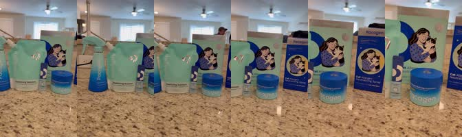

- **File:** `showing product on counter.mov`
- **Shoot A** · 6.3s · 2160x3840 · 30fps · wide → medium, slow push-in
- **What's in it:** All Pacagen products lined up on granite counter (spray bottle, stabilizing solution pouch, Cat Allergen Neutralizing Spray box, supplement tub). Slow handheld push-in from wide to the boxes.
- **Use for:** Brand reveal, 'this is the whole kit', CTA end card background
- **Cat:** none · **Tags:** lineup, packshot, counter, spray, supplement, box

### `PRD-02` Full lineup on counter — slide left→right
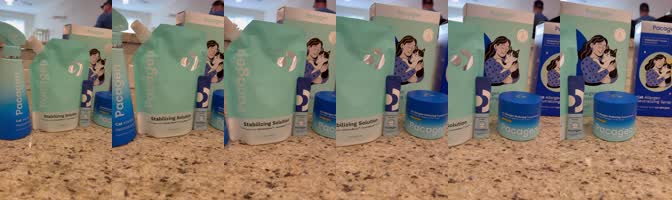

- **File:** `showing product on counter 2.mov`
- **Shoot A** · 3.4s · 2160x3840 · 30fps · medium close, lateral slide
- **What's in it:** Same lineup, closer, lateral slide across the pouch, powder stick and supplement tub.
- **Use for:** Quick product flash, transition between sections
- **Cat:** none · **Tags:** lineup, packshot, counter

### `PRD-03` Creator unboxes / presents each product
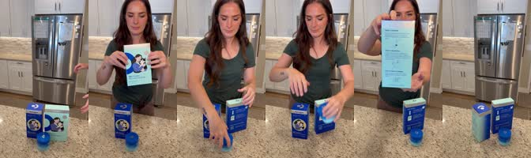

- **File:** `showing each product.mov`
- **Shoot A** · 21.9s · 2160x3840 · 30fps · static medium, creator on camera
- **What's in it:** Creator behind kitchen counter holds up each item: spray box front (0:03-0:05), box back 'Inside this pack' (0:06-0:08), opens supplement tub (0:09-0:13), spray box again (0:14-0:16), instructions card (0:16-0:18). Ends on products alone (0:19-0:22).
- **Use for:** 'Here's what you get', unboxing beat, product-explainer section
- **Best section:** 0:03-0:18
- **Note:** Best single clip to explain the kit
- **Cat:** none · **Tags:** creator, unboxing, talking-head-style, kitchen, box, supplement

### `PRD-04` Supplement tub in hand — rotate to logo
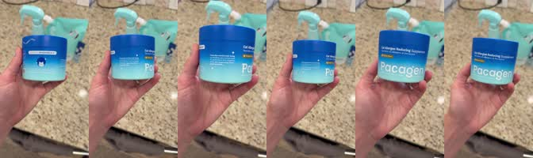

- **File:** `supplement side view.mov`
- **Shoot A** · 9.2s · 2160x3840 · 30fps · close-up, handheld rotate
- **What's in it:** Hand holds Cat Allergen Reducing Supplement tub, rotates from side label to front 'Pacagen' logo. Spray + pouch blurred behind.
- **Use for:** Supplement mention, 'just add a scoop to food'
- **Note:** Ends on logo, good hold frame
- **Cat:** none · **Tags:** supplement, tub, hand, closeup, logo

### `PRD-05` Supplement tub back label
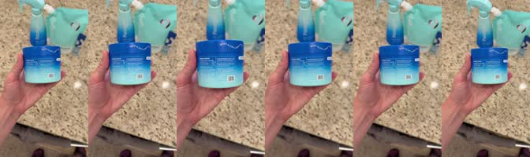

- **File:** `back side of package supplement.mov`
- **Shoot A** · 3.4s · 2160x3840 · 30fps · close-up handheld
- **What's in it:** Hand holds supplement tub showing back label / barcode.
- **Use for:** Ingredients / 'it's safe' claims
- **Cat:** none · **Tags:** supplement, back-label, closeup

### `PRD-06` Spray box back — 3-step instructions
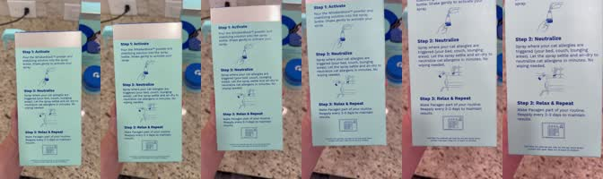

- **File:** `showing the back side of package 1.mov`
- **Shoot A** · 3.8s · 2160x3840 · 30fps · close-up, push-in
- **What's in it:** Hand holds box back: Step 1 Activate, Step 2 Neutralize, Step 3 Relax & Repeat. Push-in to Step 2/3 text.
- **Use for:** 'How it works' — 3 steps; pair with on-screen text
- **Cat:** none · **Tags:** box, instructions, steps, how-it-works

### `PRD-07` Dark-blue box back — 'Inside this pack'
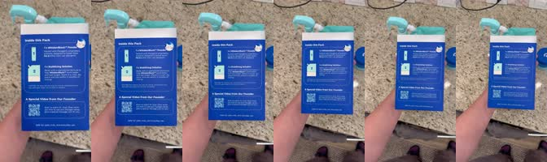

- **File:** `backside of package 2.mov` (also on Drive as `IMG_0102.mov`)
- **Shoot A** · 2.0s · 2160x3840 · 30fps · close-up handheld
- **What's in it:** Hand holds blue box back: 1x WhiskerBlock powder, 1x Stabilizing solution, special video from founder (QR). Short (2s).
- **Use for:** 'What's inside the pack' flash
- **Note:** Same file as IMG_0102
- **Cat:** none · **Tags:** box, inside-this-pack, closeup

### `PRD-08` WhiskerBlock powder stick in hand
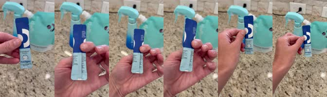

- **File:** `whisker block powder.mov`
- **Shoot A** · 8.0s · 2160x3840 · 30fps · close-up handheld
- **What's in it:** Fingers hold the blue WhiskerBlock powder stick sachet, turn it to show the back. Spray bottle behind.
- **Use for:** Step 1 'pour the powder in'
- **Cat:** none · **Tags:** powder, whiskerblock, sachet, closeup

### `PRD-09` Spray bottle tossed/placed on bathroom counter (green tile)
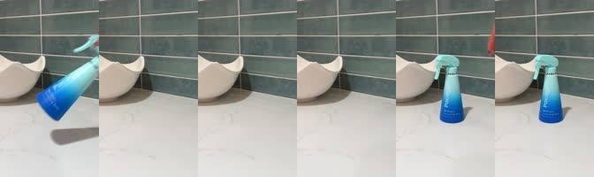

- **File:** `ALL SPRAY B-ROLL/bottle`
- **Shoot B** · 16.2s · 2160x3840 · 60fps · hand places bottle, static
- **Use for:** Product reveal, packshot, CTA end card
- **Note:** logo hold end
- **Cat:** none · **Tags:** bathroom, bottle, counter, placed, product, spray, tossed

### `PRD-10` Spray bottle turned in hands, sunny window
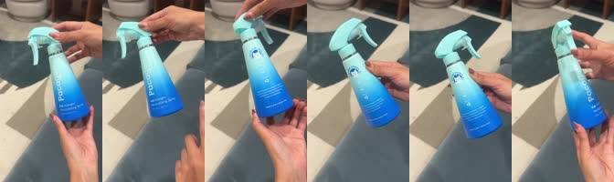

- **File:** `ALL SPRAY B-ROLL/bottle`
- **Shoot B** · 30.4s · 2160x3840 · 60fps · close handheld
- **Use for:** Product reveal, packshot, CTA end card
- **Note:** label + logo
- **Cat:** none · **Tags:** bottle, hands, product, spray, sunny, turned, window

### `PRD-11` Hand holds spray bottle, pulls away to reveal tabby (Tiger) sleeping on fluffy bed
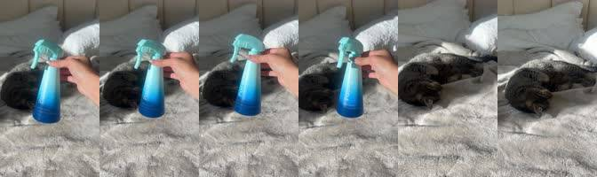

- **File:** `ALL SPRAY B-ROLL/bottle in front of cat`
- **Shoot B** · 13.9s · 2160x3840 · 60fps · rack focus reveal
- **Use for:** Product reveal, packshot, CTA end card
- **Note:** product+cat reveal
- **Cat:** tiger · **Tags:** away, bottle, hand, holds, product, pulls, spray, tiger

### `PRD-12` Spray box rotated: front, side, back 3-step instructions
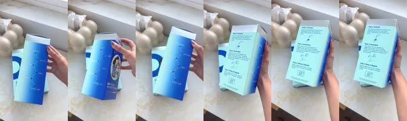

- **File:** `ALL SPRAY B-ROLL/box back & side`
- **Shoot B** · 12.3s · 2160x3840 · 60fps · close handheld
- **Use for:** Product reveal, packshot, CTA end card
- **Note:** how it works
- **Cat:** none · **Tags:** back, box, front, product, rotated, side, spray

### `PRD-13` Two spray boxes (single pack + blue twin pack) on marble
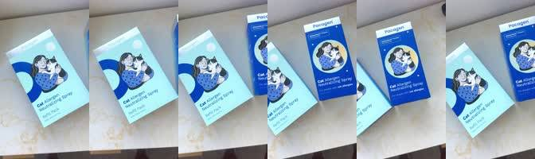

- **File:** `ALL SPRAY B-ROLL/boxes`
- **Shoot B** · 8.7s · 2160x3840 · 60fps · handheld
- **Use for:** Product reveal, packshot, CTA end card
- **Note:** lineup
- **Cat:** none · **Tags:** blue, boxes, pack, product, single, spray, two

### `PRD-14` Blue twin-pack box lifted, rotated to logo top
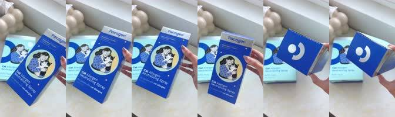

- **File:** `ALL SPRAY B-ROLL/boxes`
- **Shoot B** · 8.5s · 2160x3840 · 60fps · handheld
- **Use for:** Product reveal, packshot, CTA end card
- **Cat:** none · **Tags:** blue, box, lifted, pack, product, rotated, twin

### `PRD-15` Creator B1 (blue top, red lips) holds spray box by face, points at it

- **File:** `ALL SPRAY B-ROLL/creator with box`
- **Shoot B** · 12.0s · 2160x3840 · 60fps · selfie medium
- **Use for:** Product reveal, packshot, CTA end card
- **Note:** creator recommends, hook
- **Cat:** none · **Tags:** blue, creator, holds, hook, lips, product, red, top

### `PRD-16` Pacagen logo on box top close-up

- **File:** `ALL SPRAY B-ROLL/logo on box`
- **Shoot B** · 10.4s · 2160x3840 · 60fps · close
- **Use for:** Product reveal, packshot, CTA end card
- **Note:** logo/CTA
- **Cat:** none · **Tags:** box, close, logo, pacagen, product, top

### `PRD-17` Hand picks up spray bottle in bathroom, label to camera
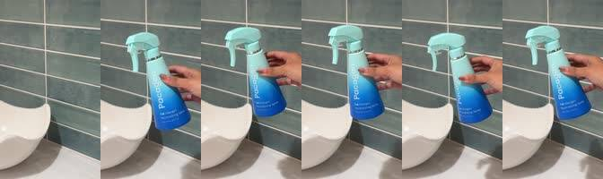

- **File:** `ALL SPRAY B-ROLL/spray bottle`
- **Shoot B** · 14.1s · 2160x3840 · 60fps · close
- **Use for:** Product reveal, packshot, CTA end card
- **Cat:** none · **Tags:** bathroom, bottle, hand, label, picks, product, spray

### `PRD-18` Hand lifts spray bottle into frame, bedroom background
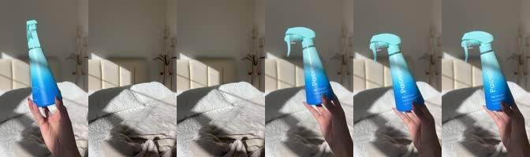

- **File:** `ALL SPRAY B-ROLL/spray bottle 1`
- **Shoot B** · 14.1s · 2160x3840 · 60fps · close
- **Use for:** Product reveal, packshot, CTA end card
- **Cat:** none · **Tags:** bedroom, bottle, frame, hand, lifts, product, spray

### `PRD-19` Spray bottle over striped bedding, push in to label
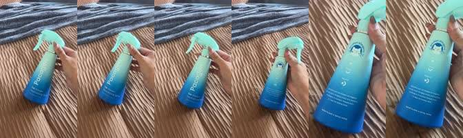

- **File:** `ALL SPRAY B-ROLL/spray on guest bed`
- **Shoot B** · 10.6s · 2160x3840 · 60fps · close push-in
- **Use for:** Product reveal, packshot, CTA end card
- **Cat:** none · **Tags:** bedding, bottle, over, product, push, spray, striped

### `PRD-20` Unboxing spray kit: box opened, pouch + bottle pulled out
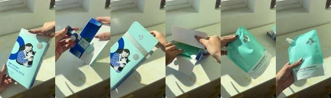

- **File:** `ALL SPRAY B-ROLL/unboxing`
- **Shoot B** · 45.4s · 2160x3840 · 60fps · close handheld
- **What's in it:** Unboxing spray kit: box opened, pouch + bottle pulled out (45s)
- **Use for:** Product reveal, packshot, CTA end card
- **Note:** unboxing
- **Cat:** none · **Tags:** box, kit, opened, pouch, product, spray, unboxing

### `PRD-21` Supplement tub back label rotated in hand, white bg
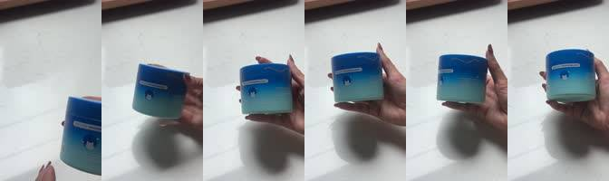

- **File:** `ALL SUPPLEMENT B-ROLL/back of supplement`
- **Shoot B** · 12.4s · 2160x3840 · 60fps · close
- **Use for:** Product reveal, packshot, CTA end card
- **Cat:** none · **Tags:** back, hand, label, product, rotated, supplement, tub

### `PRD-22` Supplement tub rotated in hand, white bg, logo lid
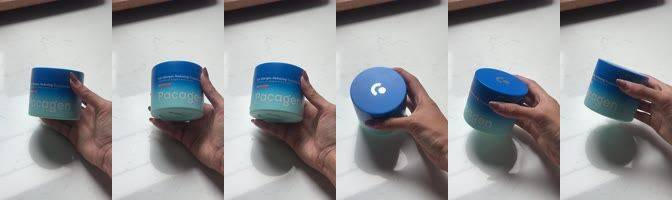

- **File:** `ALL SUPPLEMENT B-ROLL/supplement`
- **Shoot B** · 8.7s · 2160x3840 · 60fps · close
- **Use for:** Product reveal, packshot, CTA end card
- **Cat:** none · **Tags:** hand, logo, product, rotated, supplement, tub, white

### `PRD-23` Supplement tub rotated in hand, couch/tile bg
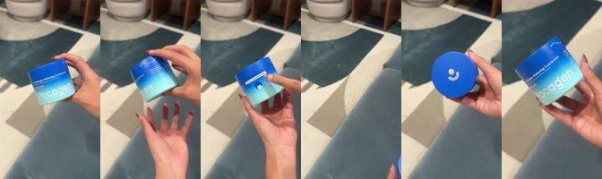

- **File:** `ALL SUPPLEMENT B-ROLL/supplement`
- **Shoot B** · 27.1s · 2160x3840 · 60fps · close
- **What's in it:** Supplement tub rotated in hand, couch/tile bg (27s)
- **Use for:** Product reveal, packshot, CTA end card
- **Cat:** none · **Tags:** couch, hand, product, rotated, supplement, tile, tub

### `PRD-24` Supplement tub placed on bathroom counter
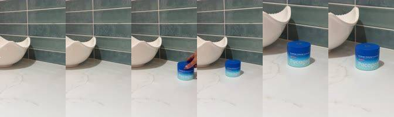

- **File:** `ALL SUPPLEMENT B-ROLL/supplement`
- **Shoot B** · 15.4s · 2160x3840 · 60fps · static
- **Use for:** Product reveal, packshot, CTA end card
- **Cat:** none · **Tags:** bathroom, counter, placed, product, supplement, tub

### `PRD-25` Supplement tub in hand over dining table, rotate to lid logo
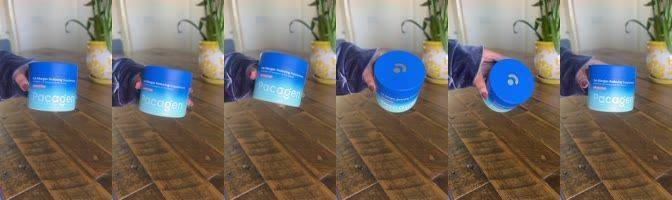

- **File:** `ALL SUPPLEMENT B-ROLL/supplement dining table`
- **Shoot B** · 9.1s · 2160x3840 · 60fps · close
- **Use for:** Product reveal, packshot, CTA end card
- **Cat:** none · **Tags:** dining, hand, over, product, supplement, table, tub

### `PRD-26` Supplement tub in hand in front of sunny bed
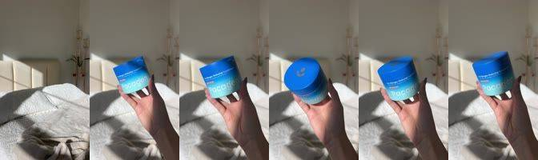

- **File:** `ALL SUPPLEMENT B-ROLL/supplement in front of bed`
- **Shoot B** · 10.3s · 2160x3840 · 60fps · close
- **Use for:** Product reveal, packshot, CTA end card
- **Cat:** none · **Tags:** bed, front, hand, product, sunny, supplement, tub

### `PRD-27` Supplement tub held in front of sleeping tabby on bed
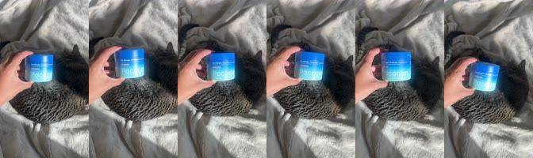

- **File:** `ALL SUPPLEMENT B-ROLL/supplement in front of cat`
- **Shoot B** · 10.6s · 2160x3840 · 60fps · close
- **Use for:** Product reveal, packshot, CTA end card
- **Note:** cat+product
- **Cat:** tiger · **Tags:** front, held, product, sleeping, supplement, tabby, tiger, tub

### `PRD-28` Supplement tub, lid ajar, slow push-in
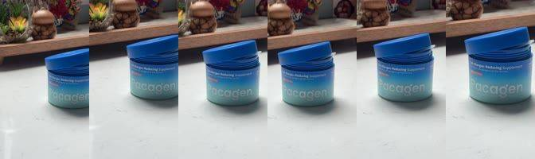

- **File:** `ALL SUPPLEMENT B-ROLL/supplement lid open`
- **Shoot B** · 8.5s · 2160x3840 · 59fps · push-in
- **Use for:** Product reveal, packshot, CTA end card
- **Note:** hero
- **Cat:** none · **Tags:** ajar, hero, lid, product, push, slow, supplement, tub

## Prep: activating the spray (powder + solution)  (5 clips)

### `PREP-01` Pouring stabilizing solution from pouch into spray bottle
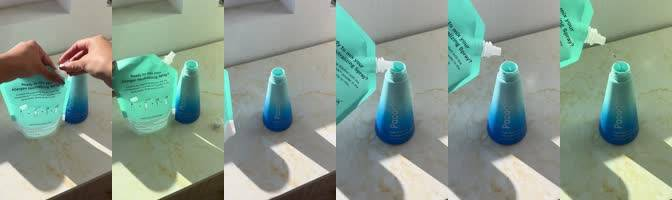

- **File:** `ALL SPRAY B-ROLL/pouring from bag`
- **Shoot B** · 58.5s · 2160x3840 · 60fps · close static
- **Use for:** How it works, Step 1 'Activate': mix the powder + solution
- **Note:** Step 1 activate; long 58s
- **Cat:** none · **Tags:** bottle, long, pouch, pouring, prep, solution, spray, stabilizing

### `PREP-02` Tearing WhiskerBlock powder stick and pouring into bottle
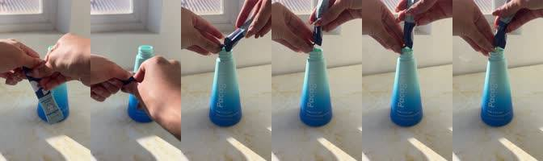

- **File:** `ALL SPRAY B-ROLL/pouring powder`
- **Shoot B** · 33.9s · 2160x3840 · 60fps · close
- **Use for:** How it works, Step 1 'Activate': mix the powder + solution
- **Note:** Step 1 activate
- **Cat:** none · **Tags:** bottle, pouring, powder, prep, stick, tearing, whiskerblock

### `PREP-03` Screwing spray trigger onto bottle
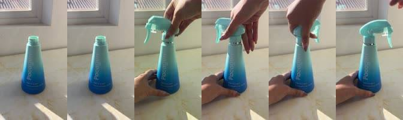

- **File:** `ALL SPRAY B-ROLL/screwing spray`
- **Shoot B** · 12.2s · 2160x3840 · 60fps · close
- **Use for:** How it works, Step 1 'Activate': mix the powder + solution
- **Note:** Step 1
- **Cat:** none · **Tags:** bottle, onto, prep, screwing, spray, trigger

### `PREP-04` Hand shakes spray bottle in front of plant
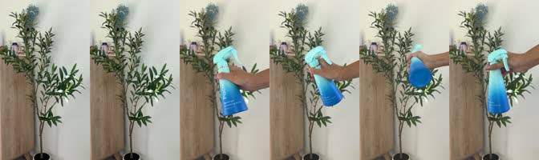

- **File:** `ALL SPRAY B-ROLL/shaking bottle`
- **Shoot B** · 24.3s · 2160x3840 · 60fps · static
- **Use for:** 'shake gently'; How it works, Step 1 'Activate': mix the powder + solution
- **Cat:** none · **Tags:** bottle, front, hand, plant, prep, shakes, spray

### `PREP-05` Unscrewing trigger, pouring/handling pouch next to bottle
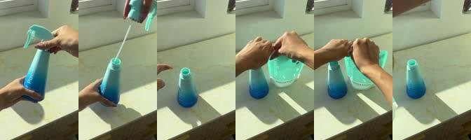

- **File:** `ALL SPRAY B-ROLL/unscrewing bottle`
- **Shoot B** · 15.9s · 2160x3840 · 60fps · close
- **Use for:** How it works, Step 1 'Activate': mix the powder + solution
- **Cat:** none · **Tags:** handling, next, pouch, pouring, prep, trigger, unscrewing

## Product in use: spraying  (22 clips)

### `USE-01` Spraying the cat tree
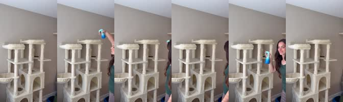

- **File:** `IMG_0112.mov`
- **Shoot A** · 10.7s · 2160x3840 · 30fps · static wide
- **What's in it:** Creator walks into frame and sprays the tall cream cat tree with the Pacagen bottle, then smiles at camera.
- **Use for:** 'Spray where your cat hangs out', application demo
- **Cat:** none · **Tags:** spray, cat-tree, creator, application

### `USE-02` Spraying the couch (sectional)
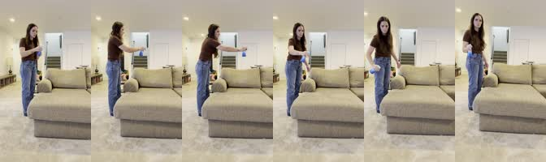

- **File:** `IMG_1109.MOV`
- **Shoot A** · 6.2s · 2160x3840 · 60fps · static wide · ⚠ HDR
- **What's in it:** Creator (brown tee, jeans) sprays a beige sectional couch, walks along it.
- **Use for:** 'Spray the couch', application demo
- **Note:** HDR (HLG) HEVC 60fps — convert to SDR/Rec709 in your NLE
- **Cat:** none · **Tags:** spray, couch, creator, application

### `USE-03` Spraying the couch — leaning across
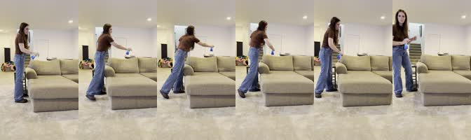

- **File:** `IMG_1110.MOV`
- **Shoot A** · 4.4s · 2160x3840 · 60fps · static wide · ⚠ HDR
- **What's in it:** Same couch, creator leans across the chaise to spray the back cushions.
- **Use for:** Alt take of USE-02
- **Note:** HDR (HLG) HEVC 60fps
- **Cat:** none · **Tags:** spray, couch, creator, application

### `USE-04` Spraying cat climbing mats / play area
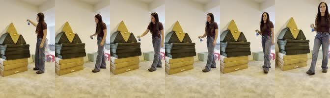

- **File:** `IMG_1108.MOV`
- **Shoot A** · 5.0s · 2160x3840 · 60fps · static wide · ⚠ HDR
- **What's in it:** Creator sprays stacked gym-mat climbing structure (yellow pyramid), turns to camera.
- **Use for:** 'Spray anywhere they nap or play'
- **Note:** HDR (HLG) HEVC 60fps
- **Cat:** none · **Tags:** spray, play-area, creator, application

### `USE-05` Spray couch → sit and read WITH the cat (88s)
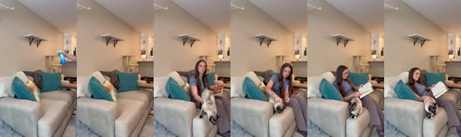

- **File:** `IMG_0165.MOV`
- **Shoot A** · 87.8s · 2160x3840 · 30fps · static wide, long take
- **What's in it:** Hand sprays couch (0:00-0:12), empty couch (0:12-0:28), creator brings in Siamese and sits (0:28-0:40), reads a book with cat cuddled beside her (0:45-1:28).
- **Use for:** Before→after in one shot; 'now I can actually sit with my cat'; happy ending
- **Best section:** 0:00-0:12 spray / 0:45-1:28 cuddle
- **Note:** Long — trim to beats; key 'solution' clip
- **Cat:** siamese · **Tags:** spray, couch, creator, cuddle, reading, after, solution, ending

### `USE-06` Siamese sniffing the spray bottle on windowsill
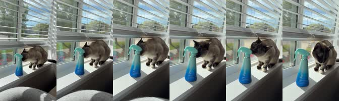

- **File:** `IMG_0114.mov`
- **Shoot A** · 6.2s · 2160x3840 · 30fps · static close
- **What's in it:** Pacagen spray bottle on sunny windowsill; Siamese walks over and sniffs it, looks up.
- **Use for:** Cute product+cat moment, 'cat-approved', safe for pets
- **Cat:** siamese · **Tags:** spray-bottle, siamese, window, sniff, cute, cat-approved

### `USE-07` Creator B1 sprays bed, wide, sunlight
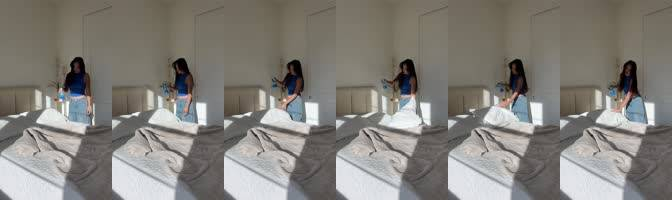

- **File:** `ALL SPRAY B-ROLL/spraying bed`
- **Shoot B** · 10.8s · 2160x3840 · 58fps · static wide
- **Use for:** Spray demo: 'spray anywhere your cat hangs out'
- **Note:** bed
- **Cat:** none · **Tags:** bed, creator, in-use, sprays, sunlight, wide

### `USE-08` Creator B1 sprays carpet runner on checkered entryway floor, mist in sunlight
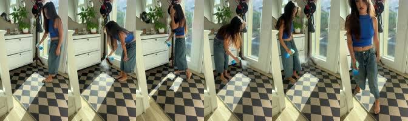

- **File:** `ALL SPRAY B-ROLL/spraying carpet entryway`
- **Shoot B** · 13.6s · 2160x3840 · 59fps · static wide
- **Use for:** Spray demo: 'spray anywhere your cat hangs out'
- **Note:** visible mist
- **Cat:** none · **Tags:** carpet, checkered, creator, entryway, in-use, mist, runner, sprays

### `USE-09` Hand sprays cat tree by window (arm only)
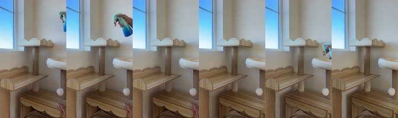

- **File:** `ALL SPRAY B-ROLL/spraying cat tree`
- **Shoot B** · 7.7s · 2160x3840 · 57fps · static
- **Use for:** Spray demo: 'spray anywhere your cat hangs out'
- **Cat:** none · **Tags:** arm, cat, hand, in-use, sprays, tree, window

### `USE-10` Hand sprays cat tree bed close
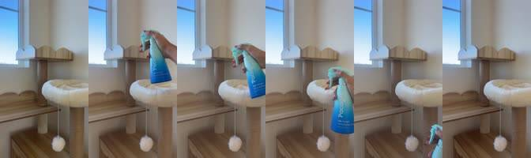

- **File:** `ALL SPRAY B-ROLL/spraying cat tree 2`
- **Shoot B** · 13.2s · 2160x3840 · 60fps · static
- **Use for:** Spray demo: 'spray anywhere your cat hangs out'
- **Cat:** none · **Tags:** bed, cat, close, hand, in-use, sprays, tree

### `USE-11` Spray mist close-up in front of door, backlit
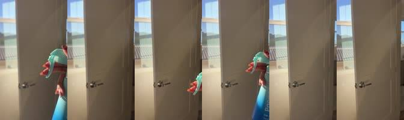

- **File:** `ALL SPRAY B-ROLL/spraying closeup`
- **Shoot B** · 5.5s · 2160x3840 · 60fps · close
- **Use for:** Spray demo: 'spray anywhere your cat hangs out'
- **Note:** mist hero
- **Cat:** none · **Tags:** backlit, close, door, front, hero, in-use, mist, spray

### `USE-12` Creator B2 (white top) sprays coffee table area
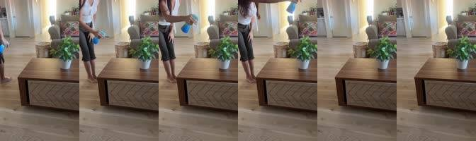

- **File:** `ALL SPRAY B-ROLL/spraying coffee table`
- **Shoot B** · 12.5s · 2160x3840 · 60fps · static wide
- **Use for:** Spray demo: 'spray anywhere your cat hangs out'
- **Cat:** none · **Tags:** coffee, creator, in-use, sprays, table, top, white

### `USE-13` Creator B2 sprays grey couch
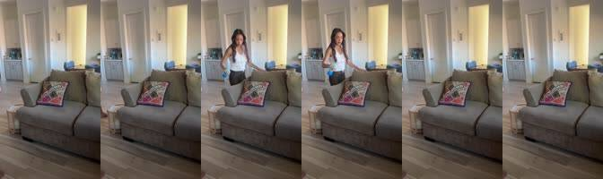

- **File:** `ALL SPRAY B-ROLL/spraying couch`
- **Shoot B** · 16.9s · 2160x3840 · 60fps · static wide
- **Use for:** Spray demo: 'spray anywhere your cat hangs out'
- **Cat:** none · **Tags:** couch, creator, grey, in-use, sprays

### `USE-14` Creator B2 sprays white desk chair
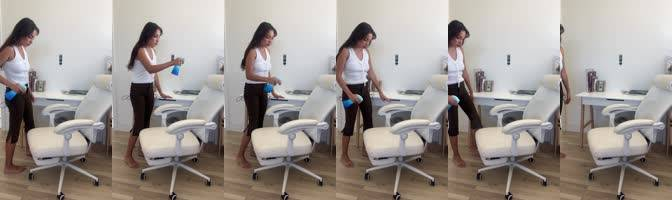

- **File:** `ALL SPRAY B-ROLL/spraying desk chair`
- **Shoot B** · 6.2s · 2160x3840 · 59fps · static
- **Use for:** Spray demo: 'spray anywhere your cat hangs out'
- **Cat:** none · **Tags:** chair, creator, desk, in-use, sprays, white

### `USE-15` Creator B2 sprays blue dining chairs
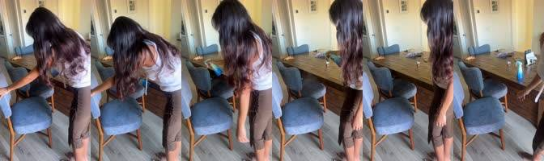

- **File:** `ALL SPRAY B-ROLL/spraying dining chairs`
- **Shoot B** · 8.6s · 2160x3840 · 58fps · handheld
- **Use for:** Spray demo: 'spray anywhere your cat hangs out'
- **Cat:** none · **Tags:** blue, chairs, creator, dining, in-use, sprays

### `USE-16` Arm sprays pillows, sunlit bed
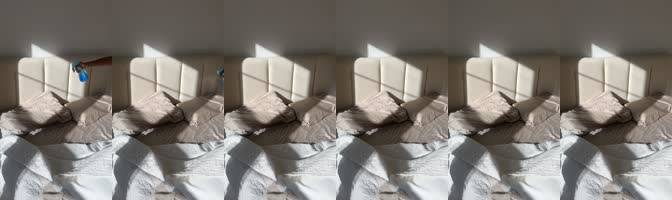

- **File:** `ALL SPRAY B-ROLL/spraying pillows`
- **Shoot B** · 9.4s · 2160x3840 · 59fps · static
- **Use for:** Spray demo: 'spray anywhere your cat hangs out'
- **Cat:** none · **Tags:** arm, bed, in-use, pillows, sprays, sunlit

### `USE-17` Creator B1 sprays pillows/bed, wide
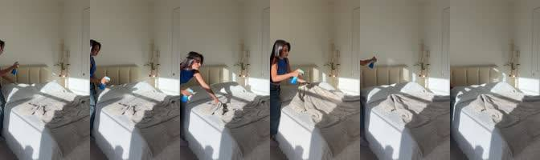

- **File:** `ALL SPRAY B-ROLL/spraying pillows`
- **Shoot B** · 15.1s · 2160x3840 · 58fps · static wide
- **Use for:** Spray demo: 'spray anywhere your cat hangs out'
- **Cat:** none · **Tags:** bed, creator, in-use, pillows, sprays, wide

### `USE-18` Creator B2 sprays tall scratcher post
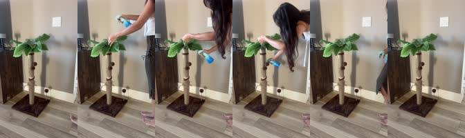

- **File:** `ALL SPRAY B-ROLL/spraying scratcher`
- **Shoot B** · 8.5s · 2160x3840 · 59fps · static
- **Use for:** Spray demo: 'spray anywhere your cat hangs out'
- **Cat:** none · **Tags:** creator, in-use, post, scratcher, sprays, tall

### `USE-19` Creator B1 sprays bed sheets, pulls sheets back
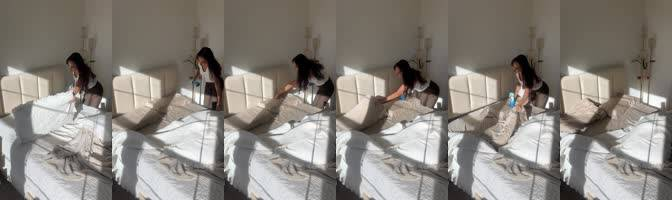

- **File:** `ALL SPRAY B-ROLL/spraying sheets`
- **Shoot B** · 22.8s · 2160x3840 · 60fps · static wide
- **What's in it:** Creator B1 sprays bed sheets, pulls sheets back (22s)
- **Use for:** Spray demo: 'spray anywhere your cat hangs out'
- **Cat:** none · **Tags:** bed, creator, in-use, pulls, sheets, sprays

### `USE-20` Creator B2 sprays carpeted stairs walking down

- **File:** `ALL SPRAY B-ROLL/spraying stairs`
- **Shoot B** · 40.3s · 1948x3462 · 60fps · static wide · ⚠ 1948x3462
- **What's in it:** Creator B2 sprays carpeted stairs walking down (40s)
- **Use for:** Spray demo: 'spray anywhere your cat hangs out'
- **Cat:** none · **Tags:** carpeted, creator, down, in-use, sprays, stairs, walking

### `USE-21` Creator B2 sprays bar stools at kitchen island

- **File:** `ALL SPRAY B-ROLL/spraying stools`
- **Shoot B** · 17.4s · 2160x3840 · 60fps · handheld
- **Use for:** Spray demo: 'spray anywhere your cat hangs out'
- **Cat:** none · **Tags:** bar, creator, in-use, island, kitchen, sprays, stools

### `USE-22` Spray mist backlit in sunlight over bed — hero mist shot

- **File:** `ALL SPRAY B-ROLL/spraying sunlight`
- **Shoot B** · 15.5s · 2160x3840 · 60fps · static close
- **Use for:** Spray demo: 'spray anywhere your cat hangs out'
- **Note:** mist hero, aesthetic
- **Cat:** none · **Tags:** backlit, bed, hero, in-use, mist, over, spray, sunlight

## Supplement: scooping & serving  (18 clips)

### `SUP-01` Sprinkling supplement onto food plate in hand

- **File:** `ALL SUPPLEMENT B-ROLL/food + supplement`
- **Shoot B** · 15.1s · 2160x3840 · 60fps · close
- **Use for:** 'Just add a scoop to their food': supplement demo
- **Cat:** none · **Tags:** food, hand, onto, plate, sprinkling, supplement

### `SUP-02` Sprinkling supplement on plate, alt

- **File:** `ALL SUPPLEMENT B-ROLL/food + supplement`
- **Shoot B** · 12.8s · 2160x3840 · 60fps · close
- **Use for:** 'Just add a scoop to their food': supplement demo
- **Cat:** none · **Tags:** alt, plate, sprinkling, supplement

### `SUP-03` Hero: tabby eats from plate, supplement tub behind on counter

- **File:** `ALL SUPPLEMENT B-ROLL/hero shot`
- **Shoot B** · 5.9s · 2160x3840 · 59fps · static
- **Use for:** 'Just add a scoop to their food': supplement demo
- **Note:** hero
- **Cat:** tiger · **Tags:** eats, hero, plate, supplement, tabby, tiger, tub

### `SUP-04` Hero: plates + supplement tub, cat head dips in

- **File:** `ALL SUPPLEMENT B-ROLL/hero shot`
- **Shoot B** · 3.9s · 2160x3840 · 60fps · static
- **Use for:** 'Just add a scoop to their food': supplement demo
- **Note:** hero
- **Cat:** tiger · **Tags:** cat, head, hero, plates, supplement, tiger, tub

### `SUP-05` Hand holds supplement jar in front of cats eating

- **File:** `ALL SUPPLEMENT B-ROLL/jar in front of cats eating`
- **Shoot B** · 7.8s · 2160x3840 · 60fps · close
- **Use for:** 'Just add a scoop to their food': supplement demo
- **Cat:** multiple · **Tags:** cats, front, hand, holds, jar, supplement

### `SUP-06` Hand holds open jar showing powder, cats eating behind

- **File:** `ALL SUPPLEMENT B-ROLL/open jar in front of cats eating`
- **Shoot B** · 12.8s · 2160x3840 · 60fps · close
- **Use for:** 'Just add a scoop to their food': supplement demo
- **Cat:** multiple · **Tags:** hand, holds, jar, open, powder, showing, supplement

### `SUP-07` Opening supplement jar on counter, scoop out powder

- **File:** `ALL SUPPLEMENT B-ROLL/opening jar + scoop`
- **Shoot B** · 19.2s · 2160x3840 · 60fps · static top
- **Use for:** 'Just add a scoop to their food': supplement demo
- **Cat:** none · **Tags:** counter, jar, opening, out, scoop, supplement

### `SUP-08` Opening supplement jar in hand, reveal powder

- **File:** `ALL SUPPLEMENT B-ROLL/opening supplement`
- **Shoot B** · 26.9s · 2160x3840 · 59fps · close
- **Use for:** 'Just add a scoop to their food': supplement demo
- **Cat:** none · **Tags:** hand, jar, opening, powder, reveal, supplement

### `SUP-09` Placing empty steel plates then supplement tub on counter

- **File:** `ALL SUPPLEMENT B-ROLL/placing plates + supplement on counter`
- **Shoot B** · 15.3s · 2160x3840 · 59fps · static top
- **Use for:** 'Just add a scoop to their food': supplement demo
- **Note:** setup
- **Cat:** none · **Tags:** empty, placing, plates, steel, supplement, tub

### `SUP-10` Pouring food + scooping supplement on plates, cat sneaks in

- **File:** `ALL SUPPLEMENT B-ROLL/pouring food + supplement`
- **Shoot B** · 109.6s · 2160x3840 · 60fps · static top
- **What's in it:** Pouring food + scooping supplement on plates, cat sneaks in (110s)
- **Use for:** 'Just add a scoop to their food': supplement demo
- **Note:** long
- **Cat:** tiger · **Tags:** cat, food, long, plates, pouring, scooping, supplement, tiger

### `SUP-11` Scooping supplement and sprinkling on food plate

- **File:** `ALL SUPPLEMENT B-ROLL/putting supplement in food`
- **Shoot B** · 32.8s · 2160x3840 · 59fps · close
- **What's in it:** Scooping supplement and sprinkling on food plate (33s)
- **Use for:** 'Just add a scoop to their food': supplement demo
- **Cat:** none · **Tags:** food, plate, scooping, sprinkling, supplement

### `SUP-12` Opening jar, lifting scoop out

- **File:** `ALL SUPPLEMENT B-ROLL/scoop+ supplement`
- **Shoot B** · 13.3s · 2160x3840 · 60fps · close
- **Use for:** 'Just add a scoop to their food': supplement demo
- **Cat:** none · **Tags:** jar, lifting, opening, out, scoop, supplement

### `SUP-13` Scoop held over open jar, lid beside

- **File:** `ALL SUPPLEMENT B-ROLL/scooper`
- **Shoot B** · 18.1s · 2160x3840 · 59fps · close top
- **Use for:** 'Just add a scoop to their food': supplement demo
- **Cat:** none · **Tags:** held, jar, lid, open, over, scoop, supplement

### `SUP-14` Scooping powder onto food plates on wooden floor

- **File:** `ALL SUPPLEMENT B-ROLL/scooping powder on food`
- **Shoot B** · 79.8s · 2160x3840 · 60fps · static top
- **What's in it:** Scooping powder onto food plates on wooden floor (80s)
- **Use for:** 'Just add a scoop to their food': supplement demo
- **Note:** long
- **Cat:** none · **Tags:** food, long, onto, plates, powder, scooping, supplement, wooden

### `SUP-15` Scooping supplement in jar held in hand, scoop full shown

- **File:** `ALL SUPPLEMENT B-ROLL/scooping supplement`
- **Shoot B** · 55.1s · 2160x3840 · 60fps · close
- **What's in it:** Scooping supplement in jar held in hand, scoop full shown (55s)
- **Use for:** 'Just add a scoop to their food': supplement demo
- **Cat:** none · **Tags:** hand, held, jar, scoop, scooping, supplement

### `SUP-16` Tub placed on counter, then steel plate set beside

- **File:** `ALL SUPPLEMENT B-ROLL/supplement +empty plate`
- **Shoot B** · 11.9s · 2160x3840 · 59fps · static
- **Use for:** 'Just add a scoop to their food': supplement demo
- **Cat:** none · **Tags:** counter, placed, plate, set, steel, supplement, tub

### `SUP-17` Tub set beside empty steel plate

- **File:** `ALL SUPPLEMENT B-ROLL/supplement in front of plates`
- **Shoot B** · 6.0s · 2160x3840 · 60fps · close
- **Use for:** 'Just add a scoop to their food': supplement demo
- **Cat:** none · **Tags:** beside, empty, plate, set, steel, supplement, tub

### `SUP-18` Opening lid and pulling scoop out

- **File:** `ALL SUPPLEMENT B-ROLL/supplement+scoop`
- **Shoot B** · 13.7s · 2160x3840 · 60fps · close
- **Use for:** 'Just add a scoop to their food': supplement demo
- **Cat:** none · **Tags:** lid, opening, out, pulling, scoop, supplement

## Feeding & cats eating  (27 clips)

### `FEED-01` Siamese eats from bowl next to supplement tub

- **File:** `Cat eating the supplements .mov` (also on Drive as `IMG_0126.mov`)
- **Shoot A** · 5.2s · 2160x3840 · 30fps · static medium
- **What's in it:** On kitchen counter: supplement tub left, Siamese eating from white bowl, looks at camera mid-way.
- **Use for:** 'I just add a scoop to her food', supplement proof
- **Note:** Same file as IMG_0126
- **Cat:** siamese · **Tags:** supplement, eating, siamese, counter, bowl

### `FEED-02` Siamese eats next to tub — push-in

- **File:** `Cat next to supplement while eating.mov`
- **Shoot A** · 7.2s · 2160x3840 · 30fps · push-in
- **What's in it:** Same set-up, slow push-in from wide to close on cat's face eating.
- **Use for:** Alt of FEED-01, more cinematic
- **Cat:** siamese · **Tags:** supplement, eating, siamese, push-in

### `FEED-03` Creator sets out bowls — then rubs nose

- **File:** `IMG_0107.mov`
- **Shoot A** · 17.7s · 2160x3840 · 30fps · static wide
- **What's in it:** Creator places three white bowls on kitchen counter (0:02-0:12), then rubs face/nose (0:13-0:14, allergy moment) and walks off.
- **Use for:** Food prep / routine; 0:13 nose-rub doubles as allergy-symptom beat
- **Best section:** 0:02-0:14
- **Cat:** none · **Tags:** creator, bowls, kitchen, routine, allergy-symptom, sneeze

### `FEED-04` Ragdoll eating at feeding tray

- **File:** `Cat eating .mov` (also on Drive as `IMG_0171.mov`)
- **Shoot A** · 4.7s · 2160x3840 · 30fps · static close
- **What's in it:** Fluffy ragdoll eating from white bowl on black feeding tray, water fountain beside.
- **Use for:** Daily routine, supplement-in-food B-roll
- **Note:** Same file as IMG_0171
- **Cat:** ragdoll · **Tags:** ragdoll, eating, feeding-tray, bowl

### `FEED-05` Ragdoll eating — wide, low-res

- **File:** `cat eating.MOV` (also on Drive as `IMG_8761.MOV`)
- **Shoot A** · 5.8s · 720x1280 · 30fps · static wide · ⚠ 720x1280
- **What's in it:** Ragdoll eating at tray from a wide angle, door behind.
- **Use for:** Backup only
- **Note:** 720p only — low quality; same file as IMG_8761
- **Cat:** ragdoll · **Tags:** ragdoll, eating, feeding-tray

### `FEED-06` Ragdoll walks up to camera past food tray

- **File:** `IMG_0170.mov`
- **Shoot A** · 3.5s · 2160x3840 · 30fps · static, subject walks in
- **What's in it:** Ragdoll walks down the hallway towards camera past the food tray, ends in tight face close-up.
- **Use for:** Hook / attention grab, 'meet my cat'
- **Note:** Great hook opener
- **Cat:** ragdoll · **Tags:** ragdoll, walk-to-camera, face, closeup, hook

### `FEED-07` Feeding station tray — slow pan

- **File:** `IMG_0169.MOV`
- **Shoot A** · 3.0s · 2160x3840 · 30fps · pan
- **What's in it:** Pan across black tray: wet food bowls, kibble, water fountain.
- **Use for:** Routine / setting the scene
- **Cat:** none · **Tags:** feeding-tray, bowls, fountain, establishing

### `FEED-08` Kibble bowls + water fountain push-in

- **File:** `IMG_0151.MOV`
- **Shoot A** · 2.9s · 2160x3840 · 30fps · push-in
- **What's in it:** Close push-in over kibble bowls to stainless water fountain.
- **Use for:** Routine / transitional
- **Cat:** none · **Tags:** kibble, fountain, closeup

### `FEED-09` Two tabbies eating raw food from metal plates on wooden table, plant behind

- **File:** `ALL SUPPLEMENT B-ROLL/cats eating`
- **Shoot B** · 17.8s · 2160x3840 · 60fps · static
- **Use for:** Daily routine, 'they love it' / palatability proof
- **Cat:** multiple · **Tags:** eating, feeding, food, metal, raw, tabbies, two

### `FEED-10` Tabbies eating, push-in close

- **File:** `ALL SUPPLEMENT B-ROLL/cats eating 2`
- **Shoot B** · 15.2s · 2160x3840 · 60fps · handheld
- **Use for:** Daily routine, 'they love it' / palatability proof
- **Cat:** multiple · **Tags:** close, eating, feeding, push, tabbies

### `FEED-11` Tabbies eating, alt angle

- **File:** `ALL SUPPLEMENT B-ROLL/cats eating 3`
- **Shoot B** · 12.5s · 2160x3840 · 60fps · handheld
- **Use for:** Daily routine, 'they love it' / palatability proof
- **Cat:** multiple · **Tags:** alt, angle, eating, feeding, tabbies

### `FEED-12` Tiger + Squirrel eating side by side on table

- **File:** `ALL SUPPLEMENT B-ROLL/cats eating tiger+squirrel`
- **Shoot B** · 6.0s · 2160x3840 · 60fps · static
- **Use for:** Daily routine, 'they love it' / palatability proof
- **Cat:** tiger + squirrel · **Tags:** eating, feeding, side, squirrel, table, tiger

### `FEED-13` Two cats (black + tabby) eating from metal bowls on rug

- **File:** `ALL SUPPLEMENT B-ROLL/eating`
- **Shoot B** · 7.8s · 2160x3840 · 60fps · static
- **Use for:** Daily routine, 'they love it' / palatability proof
- **Cat:** multiple · **Tags:** black, cats, eating, feeding, metal, tabby, two

### `FEED-14` Two cats eating on rug, handheld closer

- **File:** `ALL SUPPLEMENT B-ROLL/eating`
- **Shoot B** · 16.7s · 2160x3840 · 60fps · handheld
- **Use for:** Daily routine, 'they love it' / palatability proof
- **Cat:** multiple · **Tags:** cats, closer, eating, feeding, handheld, rug, two

### `FEED-15` Cats eating on rug with supplement tub placed beside bowl

- **File:** `ALL SUPPLEMENT B-ROLL/eating + supplement`
- **Shoot B** · 17.2s · 2160x3840 · 60fps · static
- **Use for:** Daily routine, 'they love it' / palatability proof
- **Note:** supplement in shot
- **Cat:** multiple · **Tags:** cats, eating, feeding, placed, rug, supplement, tub

### `FEED-16` Eating close-ups, tabby on rug

- **File:** `ALL SUPPLEMENT B-ROLL/eating closeups`
- **Shoot B** · 46.9s · 2160x3840 · 60fps · handheld close
- **What's in it:** Eating close-ups, tabby on rug (47s)
- **Use for:** Daily routine, 'they love it' / palatability proof
- **Cat:** multiple · **Tags:** close, eating, feeding, rug, tabby, ups

### `FEED-17` Two cats eating full plates on rug

- **File:** `ALL SUPPLEMENT B-ROLL/eating full plates`
- **Shoot B** · 6.7s · 2160x3840 · 60fps · static
- **Use for:** Daily routine, 'they love it' / palatability proof
- **Cat:** multiple · **Tags:** cats, eating, feeding, full, plates, rug, two

### `FEED-18` Empty licked-clean plates on rug

- **File:** `ALL SUPPLEMENT B-ROLL/empty plates`
- **Shoot B** · 5.6s · 2160x3840 · 60fps · handheld
- **Use for:** 'they finished every bite' - palatable; Daily routine, 'they love it' / palatability proof
- **Cat:** none · **Tags:** clean, empty, feeding, licked, plates, rug

### `FEED-19` Tabby eating raw food on wooden floor, close

- **File:** `ALL SUPPLEMENT B-ROLL/IMG_0451.MOV`
- **Shoot B** · 88.0s · 2160x3840 · 60fps · close static
- **What's in it:** Tabby eating raw food on wooden floor, close (88s)
- **Use for:** Daily routine, 'they love it' / palatability proof
- **Note:** long
- **Cat:** tiger · **Tags:** eating, feeding, floor, food, long, raw, tabby, tiger, wooden

### `FEED-20` Hand sets food plate on rug; Salem (black cat) walks in to eat

- **File:** `ALL SUPPLEMENT B-ROLL/salem near food`
- **Shoot B** · 18.2s · 2160x3840 · 60fps · static
- **Use for:** Daily routine, 'they love it' / palatability proof
- **Cat:** salem · **Tags:** feeding, food, hand, plate, rug, salem, sets

### `FEED-21` Hand sets food plate down on empty rug

- **File:** `ALL SUPPLEMENT B-ROLL/setting food down`
- **Shoot B** · 13.3s · 2160x3840 · 60fps · static
- **Use for:** Daily routine, 'they love it' / palatability proof
- **Cat:** none · **Tags:** down, empty, feeding, food, hand, plate, sets

### `FEED-22` Set food down, then Squirrel/Tiger come eat

- **File:** `ALL SUPPLEMENT B-ROLL/setting food down + cats eating`
- **Shoot B** · 30.9s · 2160x3840 · 59fps · static
- **What's in it:** Set food down, then Squirrel/Tiger come eat (31s)
- **Use for:** Daily routine, 'they love it' / palatability proof
- **Note:** before/after cat arrives
- **Cat:** multiple · **Tags:** come, down, feeding, food, set, squirrel, tiger

### `FEED-23` Squirrel + Tiger finishing their plates

- **File:** `ALL SUPPLEMENT B-ROLL/squirrel + tiger finishing food`
- **Shoot B** · 16.0s · 2160x3840 · 60fps · handheld
- **Use for:** Daily routine, 'they love it' / palatability proof
- **Note:** clean plates
- **Cat:** squirrel + tiger · **Tags:** feeding, finishing, plates, squirrel, their, tiger

### `FEED-24` Squirrel eating Tiger's leftovers, close

- **File:** `ALL SUPPLEMENT B-ROLL/squirrel eating leftovers`
- **Shoot B** · 13.7s · 2160x3840 · 60fps · handheld
- **Use for:** Daily routine, 'they love it' / palatability proof
- **Note:** funny
- **Cat:** squirrel · **Tags:** close, eating, feeding, funny, leftovers, squirrel, tiger

### `FEED-25` Squirrel eating leftovers, wide

- **File:** `ALL SUPPLEMENT B-ROLL/squirrel eating leftovers`
- **Shoot B** · 17.9s · 2160x3840 · 60fps · static
- **Use for:** Daily routine, 'they love it' / palatability proof
- **Cat:** squirrel · **Tags:** eating, feeding, leftovers, squirrel, wide

### `FEED-26` Squirrel licking plate clean

- **File:** `ALL SUPPLEMENT B-ROLL/squirrel licking plate`
- **Shoot B** · 12.6s · 2160x3840 · 60fps · handheld
- **Use for:** 'they love it'; Daily routine, 'they love it' / palatability proof
- **Cat:** squirrel · **Tags:** clean, feeding, licking, plate, squirrel

### `FEED-27` Tiger (light tabby) eating close-up from glass plate

- **File:** `ALL SUPPLEMENT B-ROLL/tigerino eating`
- **Shoot B** · 32.2s · 2160x3840 · 60fps · close static
- **What's in it:** Tiger (light tabby) eating close-up from glass plate (32s)
- **Use for:** Daily routine, 'they love it' / palatability proof
- **Cat:** tiger · **Tags:** close, eating, feeding, glass, light, tabby, tiger

## Problem: cat hair / allergy  (3 clips)

### `PROB-01` Picking cat hair out of cat bed

- **File:** `Cat hair everywhere grabbing the hair.MOV` (also on Drive as `IMG_0144.MOV`)
- **Shoot A** · 7.3s · 2160x3840 · 30fps · static close
- **What's in it:** Hand pinches clumps of cat hair from a fluffy round cat bed by a sunny window and shows it to camera.
- **Use for:** 'Cat hair EVERYWHERE', pain point / hook
- **Note:** Same file as IMG_0144
- **Cat:** none · **Tags:** cat-hair, cat-bed, hand, problem, hook

### `PROB-02` Lint-rolling cat hair off shirt

- **File:** `Lint rolling Cat hair.MOV` (also on Drive as `IMG_0146.MOV`)
- **Shoot A** · 13.6s · 2160x3840 · 30fps · handheld selfie-style
- **What's in it:** Creator in green tee lint-rolls cat hair off her shirt and pants, then shows the hairy roller close to camera.
- **Use for:** 'I was lint rolling 5 times a day', pain point
- **Note:** Same file as IMG_0146
- **Cat:** none · **Tags:** lint-roller, cat-hair, creator, clothes, problem

### `PROB-03` Brushing hair off shirt, waving it away

- **File:** `IMG_0145.MOV`
- **Shoot A** · 8.2s · 2160x3840 · 30fps · handheld selfie-style
- **What's in it:** Creator in striped window-light brushes cat hair off shirt, flicks hand, shrugs — frustrated vibe.
- **Use for:** Pain point, frustration reaction
- **Best section:** 0:01-0:07
- **Cat:** none · **Tags:** cat-hair, creator, clothes, frustrated, problem

## Problem: allergy pills, sprays & side effects  (6 clips)

### `MED-01` Creator B2 at desk, foggy/confused, head in hand — '3pm brain fog'

- **File:** `3pm fog_confused`
- **Shoot C** · 20.6s · 2160x3840 · 59fps · static medium
- **What's in it:** Creator B2 at desk, foggy/confused, head in hand — '3pm brain fog' (21s)
- **Use for:** Problem: allergy symptoms and the pills/sprays that didn't fix it
- **Note:** antihistamine side effect: drowsy
- **Cat:** none · **Tags:** allergy-meds, confused, creator, desk, foggy, hand, head, hook

### `MED-02` Hand holds Allergy Relief (cetirizine) pill box

- **File:** `allergy pills`
- **Shoot C** · 10.4s · 2160x3840 · 59fps · close
- **Use for:** 'I was taking allergy pills every day'; Problem: allergy symptoms and the pills/sprays that didn't fix it
- **Cat:** none · **Tags:** allergy, allergy-meds, cetirizine, hand, holds, pill, relief

### `MED-03` Hand holds allergy pill bottle

- **File:** `allergy pills`
- **Shoot C** · 4.6s · 2160x3840 · 60fps · close
- **Use for:** Problem: allergy symptoms and the pills/sprays that didn't fix it
- **Cat:** none · **Tags:** allergy, allergy-meds, bottle, hand, holds, pill

### `MED-04` Hand picks up nasal allergy sprays

- **File:** `allergy sprays`
- **Shoot C** · 9.3s · 2160x3840 · 60fps · close
- **Use for:** 'nasal sprays didn't help'; Problem: allergy symptoms and the pills/sprays that didn't fix it
- **Cat:** none · **Tags:** allergy, allergy-meds, hand, nasal, picks, sprays

### `MED-05` Creator B2 on stairs opening allergy pill box, annoyed

- **File:** `annoyed taking pills`
- **Shoot C** · 21.9s · 2160x3840 · 60fps · static medium
- **What's in it:** Creator B2 on stairs opening allergy pill box, annoyed (22s)
- **Use for:** Problem: allergy symptoms and the pills/sprays that didn't fix it
- **Note:** frustration
- **Cat:** none · **Tags:** allergy, allergy-meds, box, creator, opening, pill, stairs

### `MED-06` Creator B2 sitting on stairs drinking water, dry mouth

- **File:** `dry mouth_drinking water`
- **Shoot C** · 26.7s · 2160x3840 · 60fps · static wide
- **What's in it:** Creator B2 sitting on stairs drinking water, dry mouth (27s)
- **Use for:** Problem: allergy symptoms and the pills/sprays that didn't fix it
- **Note:** side effect: dry mouth
- **Cat:** none · **Tags:** allergy-meds, creator, drinking, dry, sitting, stairs, water

## Cleaning chores & air purifiers: 'what I tried before'  (10 clips)

### `CLEAN-01` Creator B2 turns on 2 air purifiers on counter

- **File:** `CLEANING_AIR PURIFIERS B-ROLL/2 air purifiers`
- **Shoot B** · 20.8s · 2160x3840 · 60fps · static
- **Use for:** 'I had 2 purifiers running'; Problem / what I tried before: endless cleaning, air purifiers
- **Cat:** none · **Tags:** air, cleaning, counter, creator, purifiers, turns

### `CLEAN-02` Creator B2 sets up air purifier by vacuum stand

- **File:** `CLEANING_AIR PURIFIERS B-ROLL/air purifier 2`
- **Shoot B** · 18.0s · 2160x3840 · 59fps · static
- **Use for:** Problem / what I tried before: endless cleaning, air purifiers
- **Cat:** none · **Tags:** air, cleaning, creator, purifier, sets, stand, vacuum

### `CLEAN-03` Creator B2 loading top-load washer with sheets

- **File:** `CLEANING_AIR PURIFIERS B-ROLL/laundry`
- **Shoot B** · 13.3s · 2160x3840 · 60fps · static
- **Use for:** 'washing sheets constantly'; Problem / what I tried before: endless cleaning, air purifiers
- **Cat:** none · **Tags:** cleaning, creator, load, loading, sheets, top, washer

### `CLEAN-04` Creator B2 moving laundry into dryer

- **File:** `CLEANING_AIR PURIFIERS B-ROLL/laundry 2`
- **Shoot B** · 22.7s · 2160x3840 · 60fps · static
- **Use for:** Problem / what I tried before: endless cleaning, air purifiers
- **Cat:** none · **Tags:** cleaning, creator, dryer, laundry, moving

### `CLEAN-05` Creator B2 (pajamas) unloading dryer, folding

- **File:** `CLEANING_AIR PURIFIERS B-ROLL/laundry 3`
- **Shoot B** · 57.3s · 2160x3840 · 60fps · static · ⚠ HDR
- **What's in it:** Creator B2 (pajamas) unloading dryer, folding (57s)
- **Use for:** Problem / what I tried before: endless cleaning, air purifiers
- **Cat:** none · **Tags:** cleaning, creator, dryer, folding, pajamas, unloading

### `CLEAN-06` Creator B2 turns on air purifier on dresser, walks to camera

- **File:** `CLEANING_AIR PURIFIERS B-ROLL/room air purifier`
- **Shoot B** · 29.5s · 2160x3840 · 59fps · static wide
- **Use for:** Problem / what I tried before: endless cleaning, air purifiers
- **Cat:** none · **Tags:** air, cleaning, creator, dresser, purifier, turns, walks

### `CLEAN-07` Creator B2 sweeping floor, wipes forehead tired

- **File:** `CLEANING_AIR PURIFIERS B-ROLL/sweeping`
- **Shoot B** · 62.8s · 2160x3840 · 60fps · static wide
- **What's in it:** Creator B2 sweeping floor, wipes forehead tired (63s)
- **Use for:** 'endless cleaning', frustration; Problem / what I tried before: endless cleaning, air purifiers
- **Cat:** none · **Tags:** cleaning, creator, floor, forehead, sweeping, tired, wipes

### `CLEAN-08` Creator B2 sweeping bedroom floor by mirror

- **File:** `CLEANING_AIR PURIFIERS B-ROLL/sweeping floor`
- **Shoot B** · 84.7s · 2160x3840 · 60fps · static wide
- **What's in it:** Creator B2 sweeping bedroom floor by mirror (85s)
- **Use for:** Problem / what I tried before: endless cleaning, air purifiers
- **Cat:** none · **Tags:** bedroom, cleaning, creator, floor, mirror, sweeping

### `CLEAN-09` Creator B2 vacuuming office floor with cordless vac

- **File:** `CLEANING_AIR PURIFIERS B-ROLL/vaccuming 3`
- **Shoot B** · 38.3s · 2160x3840 · 60fps · static wide
- **What's in it:** Creator B2 vacuuming office floor with cordless vac (38s)
- **Use for:** Problem / what I tried before: endless cleaning, air purifiers
- **Cat:** none · **Tags:** cleaning, cordless, creator, floor, office, vac, vacuuming

### `CLEAN-10` Creator B2 (purple pajamas) vacuuming kitchen floor

- **File:** `CLEANING_AIR PURIFIERS B-ROLL/vacuuming`
- **Shoot B** · 22.5s · 2160x3840 · 60fps · static wide · ⚠ HDR
- **Use for:** Problem / what I tried before: endless cleaning, air purifiers
- **Cat:** none · **Tags:** cleaning, creator, floor, kitchen, pajamas, purple, vacuuming

## Air purifier (Home A)  (3 clips)

### `AIR-01` Air purifier → pan up to Siamese on cat tree

- **File:** `Air filter.MOV` (also on Drive as `IMG_0153.MOV`)
- **Shoot A** · 8.6s · 2160x3840 · 30fps · pan / tilt up
- **What's in it:** Starts on air purifier, pans up wall past hammock and clock to Siamese lounging on top of cat tree.
- **Use for:** 'I tried air purifiers…', 'other solutions didn't work'
- **Note:** Same file as IMG_0153
- **Cat:** siamese · **Tags:** air-purifier, siamese, cat-tree, clock, pan

### `AIR-02` Air purifier display push-in

- **File:** `IMG_0152.MOV`
- **Shoot A** · 4.6s · 2160x3840 · 30fps · push-in / pull-out
- **What's in it:** Push-in to the air purifier's green ring display, then pull back out.
- **Use for:** 'Running my purifier 24/7' — what I tried before
- **Cat:** none · **Tags:** air-purifier, display, closeup

### `AIR-03` Siamese on tree → pan down to air purifier

- **File:** `IMG_0154.MOV`
- **Shoot A** · 6.2s · 2160x3840 · 30fps · pan / tilt down
- **What's in it:** Reverse of AIR-01: starts on Siamese by clock, pans down the wall to the air purifier.
- **Use for:** Alt of AIR-01
- **Cat:** siamese · **Tags:** air-purifier, siamese, cat-tree, pan

## Problem: cat locked out of the room  (3 clips)

### `DOOR-01` Open door → Siamese sitting waiting outside

- **File:** `Cat waiting at door.MOV` (also on Drive as `IMG_0164.MOV`)
- **Shoot A** · 4.4s · 2160x3840 · 30fps · handheld POV
- **What's in it:** Hand opens bedroom door to reveal Siamese sitting on the carpet waiting.
- **Use for:** 'I had to lock her out of my bedroom', emotional pain point
- **Note:** Same file as IMG_0164
- **Cat:** siamese · **Tags:** door, siamese, waiting, sad, locked-out, pov

### `DOOR-02` Siamese walking outside door gap

- **File:** `Cat locked out waiting.MOV` (also on Drive as `IMG_0162.MOV`)
- **Shoot A** · 4.2s · 2160x3840 · 30fps · static through door gap
- **What's in it:** Through a door gap, Siamese wanders in the hallway outside.
- **Use for:** Locked-out beat
- **Note:** Same file as IMG_0162
- **Cat:** siamese · **Tags:** door, siamese, locked-out

### `DOOR-03` Door closing on Siamese

- **File:** `IMG_0161.MOV`
- **Shoot A** · 5.1s · 2160x3840 · 30fps · static through door
- **What's in it:** Siamese walks out, hand closes the door on her, door reopens with her outside.
- **Use for:** 'Shutting the door on her every night'
- **Cat:** siamese · **Tags:** door, siamese, closing, locked-out

## Bonding / cuddles: the 'after'  (26 clips)

### `BOND-01` Petting ragdoll on bed

- **File:** `IMG_0131.MOV`
- **Shoot A** · 10.7s · 2160x3840 · 30fps · static close
- **What's in it:** Hand reaches in and pets ragdoll who rolls over on bed.
- **Use for:** After / 'now I can cuddle without sneezing'
- **Cat:** ragdoll · **Tags:** ragdoll, petting, hand, bonding, after, solution

### `BOND-02` Scratching ragdoll's head

- **File:** `IMG_0134.MOV`
- **Shoot A** · 11.9s · 2160x3840 · 30fps · static medium
- **What's in it:** Hand strokes and scratches sitting ragdoll's head and chin; cat leans in.
- **Use for:** After / bonding
- **Cat:** ragdoll · **Tags:** ragdoll, petting, hand, bonding, after

### `BOND-03` Belly rubs — ragdoll on back

- **File:** `IMG_0136.MOV`
- **Shoot A** · 13.6s · 2160x3840 · 30fps · static close
- **What's in it:** Ragdoll lying on back, hand rubs belly and chest.
- **Use for:** After / affection
- **Cat:** ragdoll · **Tags:** ragdoll, petting, belly, bonding, after

### `BOND-04` Petting ragdoll — cat closes eyes

- **File:** `IMG_0139.mov`
- **Shoot A** · 14.9s · 2160x3840 · 30fps · static close
- **What's in it:** Hand pets ragdoll's head, cat closes eyes happily.
- **Use for:** After / content cat
- **Cat:** ragdoll · **Tags:** ragdoll, petting, bonding, after, content

### `BOND-05` Creator B1 (navy velvet) sits on bed petting 2 tabbies

- **File:** `GENERAL CAT B-ROLL/2 cats on bed pets`
- **Shoot B** · 25.3s · 2160x3840 · 59fps · static
- **Use for:** After / result: closeness with your cats, no sneezing
- **Cat:** multiple · **Tags:** bed, bonding, creator, navy, petting, sits, velvet

### `BOND-06` Creator B3 lying in bed with tabby on chest, sunlit

- **File:** `GENERAL CAT B-ROLL/bed`
- **Shoot B** · 45.3s · 2160x3840 · 60fps · selfie · ⚠ HDR
- **What's in it:** Creator B3 lying in bed with tabby on chest, sunlit (45s)
- **Use for:** After / result: closeness with your cats, no sneezing
- **Note:** cuddle
- **Cat:** squirrel · **Tags:** bed, bonding, chest, creator, lying, squirrel, sunlit, tabby

### `BOND-07` Creator B3 lying in bed cuddling Squirrel, selfie

- **File:** `GENERAL CAT B-ROLL/creator & squirrel cuddles`
- **Shoot B** · 8.6s · 1806x3212 · 60fps · selfie · ⚠ 1806x3212
- **Use for:** After / result: closeness with your cats, no sneezing
- **Cat:** squirrel · **Tags:** bed, bonding, creator, cuddling, lying, selfie, squirrel

### `BOND-08` Creator in pink hoodie sleeping/cuddling Tiger in bed

- **File:** `GENERAL CAT B-ROLL/cuddling tiger bed hoodie`
- **Shoot B** · 55.6s · 2160x3840 · 60fps · static wide · ⚠ HDR
- **What's in it:** Creator in pink hoodie sleeping/cuddling Tiger in bed (56s)
- **Use for:** After / result: closeness with your cats, no sneezing
- **Cat:** tiger · **Tags:** bonding, creator, cuddling, hoodie, pink, sleeping, tiger

### `BOND-09` Creator cuddling Squirrel napping in bed, sunlit

- **File:** `GENERAL CAT B-ROLL/cuddling with squirrel`
- **Shoot B** · 43.9s · 1634x2906 · 60fps · static wide · ⚠ HDR ⚠ 1634x2906
- **What's in it:** Creator cuddling Squirrel napping in bed, sunlit (44s)
- **Use for:** After / result: closeness with your cats, no sneezing
- **Cat:** squirrel · **Tags:** bed, bonding, creator, cuddling, napping, squirrel, sunlit

### `BOND-10` Creator on orange pumpkin-print bed holding Squirrel — LANDSCAPE 16:9

- **File:** `GENERAL CAT B-ROLL/guest room squirrel`
- **Shoot B** · 4.2s · 3840x2160 · 60fps · static wide · ⚠ 3840x2160
- **Use for:** After / result: closeness with your cats, no sneezing
- **Note:** horizontal clip; LANDSCAPE 16:9: crop or reframe for vertical
- **Cat:** squirrel · **Tags:** bed, bonding, creator, holding, orange, print, pumpkin, squirrel

### `BOND-11` Creator reading on orange bed, cats around, waves

- **File:** `GENERAL CAT B-ROLL/guest room squirrel 1`
- **Shoot B** · 12.3s · 2160x3840 · 60fps · static wide
- **Use for:** After / result: closeness with your cats, no sneezing
- **Cat:** multiple · **Tags:** around, bed, bonding, cats, creator, orange, reading

### `BOND-12` Squirrel kneading, hand pets back

- **File:** `GENERAL CAT B-ROLL/kneading`
- **Shoot B** · 16.1s · 2160x3840 · 60fps · close top · ⚠ HDR
- **Use for:** After / result: closeness with your cats, no sneezing
- **Cat:** squirrel · **Tags:** back, bonding, hand, kneading, pets, squirrel

### `BOND-13` POV petting kneading tabby, legs in frame

- **File:** `GENERAL CAT B-ROLL/petting + kneading`
- **Shoot B** · 14.6s · 2160x3840 · 60fps · pov · ⚠ HDR
- **Use for:** After / result: closeness with your cats, no sneezing
- **Cat:** squirrel · **Tags:** bonding, frame, kneading, legs, petting, pov, squirrel, tabby

### `BOND-14` POV pets Squirrel on bed, cat walks over to lap

- **File:** `GENERAL CAT B-ROLL/pov pets w squirrel`
- **Shoot B** · 20.4s · 2040x3626 · 60fps · pov · ⚠ 2040x3626
- **Use for:** After / result: closeness with your cats, no sneezing
- **Cat:** squirrel · **Tags:** bed, bonding, cat, pets, pov, squirrel, walks

### `BOND-15` POV petting Tiger sitting on lap/blanket

- **File:** `GENERAL CAT B-ROLL/pov tiger pets`
- **Shoot B** · 20.6s · 2160x3840 · 60fps · pov
- **Use for:** After / result: closeness with your cats, no sneezing
- **Cat:** tiger · **Tags:** blanket, bonding, lap, petting, pov, sitting, tiger

### `BOND-16` Creator reading in bed while Tiger + Salem lounge on bed

- **File:** `GENERAL CAT B-ROLL/reading on bed w cats`
- **Shoot B** · 97.4s · 2160x3840 · 60fps · static wide
- **What's in it:** Creator reading in bed while Tiger + Salem lounge on bed (97s)
- **Use for:** After / result: closeness with your cats, no sneezing
- **Note:** long, 'now we share the bed'
- **Cat:** tiger + salem · **Tags:** bed, bonding, creator, long, reading, salem, tiger, while

### `BOND-17` Salem close-up being scratched on lap

- **File:** `GENERAL CAT B-ROLL/salem closeup bed`
- **Shoot B** · 15.9s · 2160x3840 · 60fps · selfie close · ⚠ HDR
- **Use for:** After / result: closeness with your cats, no sneezing
- **Cat:** salem · **Tags:** being, bonding, close, lap, salem, scratched

### `BOND-18` Creator B3 (pink hoodie) carries Salem walking on street, smiling

- **File:** `GENERAL CAT B-ROLL/salem in hoodie street`
- **Shoot B** · 16.1s · 2160x3840 · 60fps · selfie walking · ⚠ HDR
- **Use for:** After / result: closeness with your cats, no sneezing
- **Cat:** salem · **Tags:** bonding, carries, creator, hoodie, pink, salem, walking

### `BOND-19` Creator B3 holds Salem in pet carrier-hoodie, poses to camera

- **File:** `GENERAL CAT B-ROLL/salem in jacket`
- **Shoot B** · 54.1s · 2160x3840 · 60fps · static selfie · ⚠ HDR
- **What's in it:** Creator B3 holds Salem in pet carrier-hoodie, poses to camera (54s)
- **Use for:** After / result: closeness with your cats, no sneezing
- **Cat:** salem · **Tags:** bonding, carrier, creator, holds, hoodie, pet, salem

### `BOND-20` Creator B3 sits on floral bed petting Salem, Salem rolls

- **File:** `GENERAL CAT B-ROLL/salem on bed pets`
- **Shoot B** · 50.4s · 2160x3840 · 60fps · static
- **What's in it:** Creator B3 sits on floral bed petting Salem, Salem rolls (50s)
- **Use for:** After / result: closeness with your cats, no sneezing
- **Cat:** salem · **Tags:** bed, bonding, creator, floral, petting, salem, sits

### `BOND-21` Creator B3 lies on bed petting Salem while Tiger lounges

- **File:** `GENERAL CAT B-ROLL/salem pets tiger on bed`
- **Shoot B** · 35.7s · 2160x3840 · 60fps · static wide
- **What's in it:** Creator B3 lies on bed petting Salem while Tiger lounges (36s)
- **Use for:** After / result: closeness with your cats, no sneezing
- **Cat:** salem + tiger · **Tags:** bed, bonding, creator, lies, petting, salem, tiger, while

### `BOND-22` Tiger sleeping on carpet in sun, hand pets

- **File:** `GENERAL CAT B-ROLL/sleeping on carpet`
- **Shoot B** · 42.5s · 2160x3840 · 60fps · static low · ⚠ HDR
- **What's in it:** Tiger sleeping on carpet in sun, hand pets (43s)
- **Use for:** After / result: closeness with your cats, no sneezing
- **Cat:** tiger · **Tags:** bonding, carpet, hand, pets, sleeping, sun, tiger

### `BOND-23` Creator B3 (tan hoodie) lying on bed petting Squirrel

- **File:** `GENERAL CAT B-ROLL/squirrel pets`
- **Shoot B** · 55.0s · 2160x3840 · 60fps · static · ⚠ HDR
- **What's in it:** Creator B3 (tan hoodie) lying on bed petting Squirrel (55s)
- **Use for:** After / result: closeness with your cats, no sneezing
- **Cat:** squirrel · **Tags:** bed, bonding, creator, hoodie, lying, petting, squirrel, tan

### `BOND-24` Creator B3 (pink hoodie) lying in bed cuddling Tiger

- **File:** `GENERAL CAT B-ROLL/tiger in hoodie bed`
- **Shoot B** · 35.8s · 2160x3840 · 60fps · static wide · ⚠ HDR
- **What's in it:** Creator B3 (pink hoodie) lying in bed cuddling Tiger (36s)
- **Use for:** After / result: closeness with your cats, no sneezing
- **Cat:** tiger · **Tags:** bed, bonding, creator, cuddling, hoodie, lying, pink, tiger

### `BOND-25` Creator B3 selfie lying in bed with Tiger beside, smiling

- **File:** `GENERAL CAT B-ROLL/tiger in hoodie bed`
- **Shoot B** · 6.1s · 1876x3336 · 60fps · selfie · ⚠ HDR ⚠ 1876x3336
- **Use for:** After / result: closeness with your cats, no sneezing
- **Cat:** tiger · **Tags:** bed, beside, bonding, creator, lying, selfie, tiger

### `BOND-26` Creator B3 leans over bed petting Tiger

- **File:** `GENERAL CAT B-ROLL/tiger pets on bed`
- **Shoot B** · 13.8s · 2160x3840 · 58fps · static
- **Use for:** After / result: closeness with your cats, no sneezing
- **Cat:** tiger · **Tags:** bed, bonding, creator, leans, over, petting, tiger

## Tiger, Squirrel & Salem lifestyle (Home B)  (38 clips)

### `HOME-01` Hand feeds lickable treat to Tiger + Salem on bed

- **File:** `GENERAL CAT B-ROLL/2 cats eating treat`
- **Shoot B** · 9.7s · 2160x3840 · 60fps · close
- **Use for:** Lifestyle filler, cute cat moments, pacing
- **Note:** cute
- **Cat:** tiger + salem · **Tags:** cute, feeds, hand, household, lickable, salem, tiger, treat

### `HOME-02` Squirrel + Tiger climbing cat tree

- **File:** `GENERAL CAT B-ROLL/2 cats on cat tree`
- **Shoot B** · 40.4s · 2160x3840 · 59fps · static · ⚠ HDR
- **What's in it:** Squirrel + Tiger climbing cat tree (40s)
- **Use for:** Lifestyle filler, cute cat moments, pacing
- **Cat:** squirrel + tiger · **Tags:** cat, climbing, household, squirrel, tiger, tree

### `HOME-03` Tabby grooming paw on bed

- **File:** `GENERAL CAT B-ROLL/grooming on bed`
- **Shoot B** · 16.1s · 2160x3840 · 59fps · close
- **Use for:** Lifestyle filler, cute cat moments, pacing
- **Cat:** tiger · **Tags:** bed, grooming, household, paw, tabby, tiger

### `HOME-04` Squirrel kneading blanket (making biscuits), top-down

- **File:** `GENERAL CAT B-ROLL/kneading`
- **Shoot B** · 7.2s · 2160x3840 · 60fps · close top · ⚠ HDR
- **Use for:** Lifestyle filler, cute cat moments, pacing
- **Cat:** squirrel · **Tags:** biscuits, blanket, household, kneading, making, squirrel, top

### `HOME-05` Tabby in grey sweater on bed by plant

- **File:** `GENERAL CAT B-ROLL/kneading w sweater`
- **Shoot B** · 11.2s · 2160x3840 · 60fps · static · ⚠ HDR
- **Use for:** Lifestyle filler, cute cat moments, pacing
- **Note:** cute outfit
- **Cat:** squirrel · **Tags:** bed, cute, grey, household, plant, squirrel, sweater, tabby

### `HOME-06` Salem (black cat) rolling on floor, looks up, close

- **File:** `GENERAL CAT B-ROLL/salem`
- **Shoot B** · 7.3s · 2160x3840 · 52fps · handheld · ⚠ HDR
- **Use for:** Lifestyle filler, cute cat moments, pacing
- **Note:** starts with red frame - trim first 1s
- **Cat:** salem · **Tags:** black, cat, floor, household, looks, rolling, salem

### `HOME-07` Salem + Squirrel outside on patio chair/ground

- **File:** `GENERAL CAT B-ROLL/salem & squirrel outside`
- **Shoot B** · 8.7s · 2160x3840 · 60fps · static
- **Use for:** Lifestyle filler, cute cat moments, pacing
- **Cat:** salem + squirrel · **Tags:** chair, ground, household, outside, patio, salem, squirrel

### `HOME-08` Salem + Squirrel (in white shirt) in backyard dirt

- **File:** `GENERAL CAT B-ROLL/salem + squirrel`
- **Shoot B** · 7.1s · 2160x3840 · 60fps · static · ⚠ HDR
- **Use for:** Lifestyle filler, cute cat moments, pacing
- **Cat:** salem + squirrel · **Tags:** backyard, dirt, household, salem, shirt, squirrel, white

### `HOME-09` Salem lying on floral bedsheets

- **File:** `GENERAL CAT B-ROLL/salem on bed`
- **Shoot B** · 10.9s · 2160x3840 · 60fps · static close
- **Use for:** Lifestyle filler, cute cat moments, pacing
- **Cat:** salem · **Tags:** bedsheets, floral, household, lying, salem

### `HOME-10` Salem lying on floral sheets, alt

- **File:** `GENERAL CAT B-ROLL/salem on bed`
- **Shoot B** · 6.0s · 2160x3840 · 60fps · static close
- **Use for:** Lifestyle filler, cute cat moments, pacing
- **Cat:** salem · **Tags:** alt, floral, household, lying, salem, sheets

### `HOME-11` Salem lounging on couch back, push-in to sleepy face

- **File:** `GENERAL CAT B-ROLL/salem on couch`
- **Shoot B** · 5.9s · 2160x3840 · 60fps · push-in · ⚠ HDR
- **Use for:** Lifestyle filler, cute cat moments, pacing
- **Cat:** salem · **Tags:** back, couch, household, lounging, push, salem, sleepy

### `HOME-12` Salem sleeping belly-up on rug, top-down

- **File:** `GENERAL CAT B-ROLL/salem sleeping`
- **Shoot B** · 9.4s · 2160x3840 · 30fps · static top · ⚠ HDR
- **Use for:** Lifestyle filler, cute cat moments, pacing
- **Note:** funny/cute
- **Cat:** salem · **Tags:** belly, cute, down, funny, household, rug, salem, sleeping, top

### `HOME-13` Salem sleeping in chair, extreme close-up, tongue out

- **File:** `GENERAL CAT B-ROLL/salem sleeping chair`
- **Shoot B** · 13.1s · 2160x3840 · 60fps · handheld close
- **Use for:** Lifestyle filler, cute cat moments, pacing
- **Note:** funny
- **Cat:** salem · **Tags:** chair, close, extreme, funny, household, salem, sleeping, tongue

### `HOME-14` Squirrel rubbing on window post, close, sky behind

- **File:** `GENERAL CAT B-ROLL/squirrel`
- **Shoot B** · 8.1s · 2160x3840 · 60fps · handheld close · ⚠ HDR
- **Use for:** Lifestyle filler, cute cat moments, pacing
- **Cat:** squirrel · **Tags:** close, household, post, rubbing, sky, squirrel, window

### `HOME-15` Squirrel + Salem lying on carpet near door

- **File:** `GENERAL CAT B-ROLL/squirrel & salem on carpet`
- **Shoot B** · 9.1s · 1080x1920 · 30fps · static · ⚠ HDR ⚠ 1080x1920
- **Use for:** Lifestyle filler, cute cat moments, pacing
- **Cat:** squirrel + salem · **Tags:** carpet, door, household, lying, near, salem, squirrel

### `HOME-16` Squirrel making biscuits on blanket

- **File:** `GENERAL CAT B-ROLL/squirrel biscuits` (also on Drive as `✅GENERAL CAT B-ROLL/squirrel making biscuits`)
- **Shoot B** · 8.0s · 2160x3840 · 60fps · close
- **Use for:** Lifestyle filler, cute cat moments, pacing
- **Cat:** squirrel · **Tags:** biscuits, blanket, household, making, squirrel

### `HOME-17` Squirrel in blue bow tie sitting on bed

- **File:** `GENERAL CAT B-ROLL/squirrel bow tie`
- **Shoot B** · 18.7s · 2160x3840 · 60fps · static · ⚠ HDR
- **Use for:** Lifestyle filler, cute cat moments, pacing
- **Note:** cute, hero
- **Cat:** squirrel · **Tags:** bed, blue, bow, cute, hero, hook, household, sitting, squirrel, tie

### `HOME-18` Squirrel grooming outside on patio

- **File:** `GENERAL CAT B-ROLL/squirrel grooming outside`
- **Shoot B** · 5.2s · 2160x3840 · 60fps · static
- **Use for:** Lifestyle filler, cute cat moments, pacing
- **Cat:** squirrel · **Tags:** grooming, household, outside, patio, squirrel

### `HOME-19` Squirrel in grey sweater on bed

- **File:** `GENERAL CAT B-ROLL/squirrel in sweater`
- **Shoot B** · 9.1s · 2160x3840 · 60fps · static · ⚠ HDR
- **Use for:** Lifestyle filler, cute cat moments, pacing
- **Note:** cute outfit
- **Cat:** squirrel · **Tags:** bed, cute, grey, household, squirrel, sweater

### `HOME-20` Squirrel napping on bed, push-in, sunlit

- **File:** `GENERAL CAT B-ROLL/squirrel napping on bed`
- **Shoot B** · 6.2s · 2160x3840 · 59fps · push-in
- **Use for:** Lifestyle filler, cute cat moments, pacing
- **Cat:** squirrel · **Tags:** bed, household, napping, push, squirrel, sunlit

### `HOME-21` Squirrel napping on bed, wide

- **File:** `GENERAL CAT B-ROLL/squirrel napping on bed` (also on Drive as `✅GENERAL CAT B-ROLL/squirrel sleeping blanket`)
- **Shoot B** · 8.6s · 2160x3840 · 60fps · static
- **Use for:** Lifestyle filler, cute cat moments, pacing
- **Cat:** squirrel · **Tags:** bed, household, napping, squirrel, wide

### `HOME-22` Squirrel lounging on white sheets in sunlight, looks up

- **File:** `GENERAL CAT B-ROLL/squirrel on sheets`
- **Shoot B** · 9.1s · 2160x3840 · 60fps · handheld · ⚠ HDR
- **Use for:** Lifestyle filler, cute cat moments, pacing
- **Cat:** squirrel · **Tags:** household, looks, lounging, sheets, squirrel, sunlight, white

### `HOME-23` Squirrel lying on white bed, wide

- **File:** `GENERAL CAT B-ROLL/squirrel on sheets`
- **Shoot B** · 5.0s · 2160x3840 · 60fps · static · ⚠ HDR
- **Use for:** Lifestyle filler, cute cat moments, pacing
- **Cat:** squirrel · **Tags:** bed, household, lying, squirrel, white, wide

### `HOME-24` Tiger + Salem lying on floral bed

- **File:** `GENERAL CAT B-ROLL/tiger & salem on bed`
- **Shoot B** · 11.3s · 2160x3840 · 60fps · static wide
- **Use for:** Lifestyle filler, cute cat moments, pacing
- **Cat:** tiger + salem · **Tags:** bed, floral, household, lying, salem, tiger

### `HOME-25` Tiger + Salem on floral bed, alt

- **File:** `GENERAL CAT B-ROLL/tiger & salem on bed`
- **Shoot B** · 11.2s · 2160x3840 · 60fps · static wide
- **Use for:** Lifestyle filler, cute cat moments, pacing
- **Cat:** tiger + salem · **Tags:** alt, bed, floral, household, salem, tiger

### `HOME-26` Tiger + Squirrel sitting on dining table by window

- **File:** `GENERAL CAT B-ROLL/tiger & squirrel on table`
- **Shoot B** · 8.3s · 2160x3840 · 60fps · handheld push-in · ⚠ HDR
- **Use for:** Lifestyle filler, cute cat moments, pacing
- **Cat:** tiger + squirrel · **Tags:** dining, household, sitting, squirrel, table, tiger, window

### `HOME-27` Tiger lounging on cat tree perch, push-in

- **File:** `GENERAL CAT B-ROLL/tiger cat tree`
- **Shoot B** · 16.4s · 2160x3840 · 60fps · push-in · ⚠ HDR
- **Use for:** Lifestyle filler, cute cat moments, pacing
- **Cat:** tiger · **Tags:** cat, household, lounging, perch, push, tiger, tree

### `HOME-28` Tiger grooming on floral bed, pan to Salem sleeping

- **File:** `GENERAL CAT B-ROLL/tiger grooming on bed`
- **Shoot B** · 18.1s · 2160x3840 · 60fps · handheld
- **Use for:** Lifestyle filler, cute cat moments, pacing
- **Cat:** tiger + salem · **Tags:** bed, floral, grooming, household, pan, salem, tiger

### `HOME-29` Tiger walks through living room to camera, sits

- **File:** `GENERAL CAT B-ROLL/tiger in living room`
- **Shoot B** · 13.5s · 2160x3840 · 60fps · handheld · ⚠ HDR
- **Use for:** Lifestyle filler, cute cat moments, pacing
- **Cat:** tiger · **Tags:** camera, household, living, room, through, tiger, walks

### `HOME-30` Tiger in a 'king' robe costume on bed

- **File:** `GENERAL CAT B-ROLL/tiger king`
- **Shoot B** · 7.7s · 2160x3840 · 60fps · static · ⚠ HDR
- **Use for:** Lifestyle filler, cute cat moments, pacing
- **Note:** funny, hook
- **Cat:** tiger · **Tags:** bed, costume, funny, hook, household, king, robe, tiger

### `HOME-31` Tiger stretched on floral bed, push-in

- **File:** `GENERAL CAT B-ROLL/tiger on bed`
- **Shoot B** · 6.1s · 2160x3840 · 60fps · push-in
- **Use for:** Lifestyle filler, cute cat moments, pacing
- **Cat:** tiger · **Tags:** bed, floral, household, push, stretched, tiger

### `HOME-32` Tiger on floral bed, pull back to Salem on pillows

- **File:** `GENERAL CAT B-ROLL/tiger on bed`
- **Shoot B** · 10.9s · 2160x3840 · 60fps · handheld
- **Use for:** Lifestyle filler, cute cat moments, pacing
- **Cat:** tiger + salem · **Tags:** back, bed, floral, household, pull, salem, tiger

### `HOME-33` Tiger curled on couch, plays upside down with blanket

- **File:** `GENERAL CAT B-ROLL/tiger on couch`
- **Shoot B** · 24.2s · 1080x1920 · 30fps · handheld close · ⚠ HDR ⚠ 1080x1920
- **Use for:** Lifestyle filler, cute cat moments, pacing
- **Note:** cute
- **Cat:** tiger · **Tags:** couch, curled, cute, down, household, plays, tiger, upside

### `HOME-34` Tiger lying on white sheets

- **File:** `GENERAL CAT B-ROLL/tiger on sheets`
- **Shoot B** · 11.7s · 2160x3840 · 60fps · static · ⚠ HDR
- **Use for:** Lifestyle filler, cute cat moments, pacing
- **Cat:** tiger · **Tags:** household, lying, sheets, tiger, white

### `HOME-35` Tiger lying on patio outside

- **File:** `GENERAL CAT B-ROLL/tiger outside`
- **Shoot B** · 8.7s · 2160x3840 · 60fps · static
- **Use for:** Lifestyle filler, cute cat moments, pacing
- **Cat:** tiger · **Tags:** household, lying, outside, patio, tiger

### `HOME-36` Tiger lying on patio, alt

- **File:** `GENERAL CAT B-ROLL/tiger outside`
- **Shoot B** · 8.6s · 2160x3840 · 60fps · static
- **Use for:** Lifestyle filler, cute cat moments, pacing
- **Cat:** tiger · **Tags:** alt, household, lying, patio, tiger

### `HOME-37` Tiger sleeping belly-up, close, nose in focus

- **File:** `GENERAL CAT B-ROLL/tiger sleeping`
- **Shoot B** · 13.2s · 2160x3840 · 60fps · handheld close
- **Use for:** Lifestyle filler, cute cat moments, pacing
- **Note:** funny/cute
- **Cat:** tiger · **Tags:** belly, close, cute, focus, funny, household, nose, sleeping, tiger

### `HOME-38` Tiger in shirt collar + striped tie on cat tree

- **File:** `GENERAL CAT B-ROLL/tiger tie`
- **Shoot B** · 19.2s · 2160x3840 · 60fps · static · ⚠ HDR
- **Use for:** Lifestyle filler, cute cat moments, pacing
- **Note:** funny, hook
- **Cat:** tiger · **Tags:** cat, collar, funny, hook, household, shirt, striped, tie, tiger

## Siamese lifestyle (Home A)  (9 clips)

### `SIA-01` Siamese playing with feather wand

- **File:** `IMG_0122.mov`
- **Shoot A** · 5.7s · 2160x3840 · 30fps · static close
- **What's in it:** Siamese on her back batting a colourful feather wand toy on the carpet.
- **Use for:** Playful filler, 'healthy happy cat'
- **Cat:** siamese · **Tags:** siamese, play, feather-toy, cute

### `SIA-02` Siamese rolling with feather toy

- **File:** `IMG_0123.mov`
- **Shoot A** · 3.8s · 2160x3840 · 30fps · static wide
- **What's in it:** Siamese lying on side chewing/rolling with feather toys.
- **Use for:** Playful filler
- **Cat:** siamese · **Tags:** siamese, play, feather-toy

### `SIA-03` Siamese play session (14s)

- **File:** `IMG_0124.mov`
- **Shoot A** · 14.2s · 2160x3840 · 30fps · static medium
- **What's in it:** Longer play session: wand dangles, Siamese grabs and kicks the feather toy.
- **Use for:** Playful filler, longer
- **Cat:** siamese · **Tags:** siamese, play, feather-toy

### `SIA-04` Siamese on windowsill about to jump down

- **File:** `IMG_0113.mov`
- **Shoot A** · 2.1s · 2160x3840 · 30fps · static
- **What's in it:** Siamese crouched on sunny windowsill above a grey donut bed.
- **Use for:** Quick filler
- **Note:** Short (2s)
- **Cat:** siamese · **Tags:** siamese, window, sunlight

### `SIA-05` Siamese leaves window bed, walks the room

- **File:** `cat by window moving around.mov`
- **Shoot A** · 6.2s · 2160x3840 · 30fps · handheld follow
- **What's in it:** Siamese in window bed hops down and walks across the room; handheld follow.
- **Use for:** Day-in-the-life filler
- **Cat:** siamese · **Tags:** siamese, window, walk, follow

### `SIA-06` Siamese walking wall shelves → cat tree

- **File:** `IMG_0147.MOV`
- **Shoot A** · 13.0s · 2160x3840 · 30fps · handheld follow
- **What's in it:** Siamese walks along wall-mounted cat shelves then onto top of tall cat tree.
- **Use for:** Filler, 'she's everywhere in the house'
- **Cat:** siamese · **Tags:** siamese, wall-shelves, cat-tree, climb

### `SIA-07` Siamese stepping onto wall hammock

- **File:** `IMG_0148.MOV`
- **Shoot A** · 3.2s · 2160x3840 · 30fps · static low angle
- **What's in it:** Siamese steps down onto a wall-mounted hammock shelf, low angle.
- **Use for:** Filler
- **Cat:** siamese · **Tags:** siamese, wall-shelves, climb

### `SIA-08` Siamese on wall hammock, looks at camera

- **File:** `IMG_0149.MOV`
- **Shoot A** · 5.0s · 2160x3840 · 30fps · static close low angle
- **What's in it:** Siamese standing on wall hammock, looks at camera, turns.
- **Use for:** Filler / reaction cut
- **Cat:** siamese · **Tags:** siamese, wall-shelves, look-at-camera

### `SIA-09` Siamese on cat tree by clock → jumps to shelf

- **File:** `IMG_0150.MOV`
- **Shoot A** · 8.8s · 2160x3840 · 30fps · handheld
- **What's in it:** Siamese on carpeted cat tree next to clock, leaps onto wall perch.
- **Use for:** Filler with action
- **Cat:** siamese · **Tags:** siamese, cat-tree, clock, jump

## Ragdoll lifestyle (Home A)  (12 clips)

### `RAG-01` Ragdoll on bed — stares into camera

- **File:** `IMG_0132.MOV`
- **Shoot A** · 9.9s · 2160x3840 · 30fps · push-in, eye-level
- **What's in it:** Grey ragdoll lying on white bed, camera moves in, cat stares straight into lens.
- **Use for:** Hook / reaction / 'meet my other cat'
- **Note:** Strong hero shot
- **Cat:** ragdoll · **Tags:** ragdoll, bed, stare, look-at-camera, hook

### `RAG-02` Ragdoll close-up — judgy stare

- **File:** `IMG_0138.mov`
- **Shoot A** · 5.1s · 2160x3840 · 30fps · push-in close-up
- **What's in it:** Push-in to ragdoll's face, blue eyes, judgy expression.
- **Use for:** Funny reaction cut, hook
- **Cat:** ragdoll · **Tags:** ragdoll, face, closeup, stare, funny, reaction, hook

### `RAG-03` Ragdoll on bed — profile then front

- **File:** `IMG_0133.MOV`
- **Shoot A** · 7.9s · 2160x3840 · 30fps · handheld orbit
- **What's in it:** Ragdoll loaf on bed, camera circles from profile to front.
- **Use for:** Cute filler
- **Cat:** ragdoll · **Tags:** ragdoll, bed, orbit

### `RAG-04` Ragdoll loaf on bed, wooden dresser behind

- **File:** `IMG_0135.MOV`
- **Shoot A** · 5.0s · 2160x3840 · 30fps · static
- **What's in it:** Calm ragdoll lying on bed, subtle movement.
- **Use for:** Calm filler
- **Cat:** ragdoll · **Tags:** ragdoll, bed, calm

### `RAG-05` Ragdoll on bed — handheld around

- **File:** `IMG_0141.mov`
- **Shoot A** · 10.6s · 2160x3840 · 30fps · handheld orbit
- **What's in it:** Camera moves around ragdoll on bed from several angles.
- **Use for:** Filler
- **Cat:** ragdoll · **Tags:** ragdoll, bed, orbit

### `RAG-06` Ragdoll lying → sits up, looks away

- **File:** `IMG_0140.mov`
- **Shoot A** · 6.9s · 2160x3840 · 30fps · static low
- **What's in it:** Ragdoll lying on bed then sits up and turns head.
- **Use for:** Filler
- **Cat:** ragdoll · **Tags:** ragdoll, bed

### `RAG-07` Ragdoll grooming on bed

- **File:** `Grooming on bed.mov` (also on Drive as `IMG_0137.mov`)
- **Shoot A** · 7.0s · 2160x3840 · 30fps · slow pull-back
- **What's in it:** Ragdoll lying on bed grooming / looking around, door behind.
- **Use for:** Calm filler
- **Note:** Same file as IMG_0137
- **Cat:** ragdoll · **Tags:** ragdoll, bed, grooming

### `RAG-08` Ragdoll stretched out — push-in to face

- **File:** `IMG_0130.MOV`
- **Shoot A** · 4.3s · 2160x3840 · 30fps · push-in
- **What's in it:** Ragdoll lying stretched on bed; push-in to relaxed face.
- **Use for:** Relaxed / 'finally calm' beat
- **Cat:** ragdoll · **Tags:** ragdoll, bed, relaxed, push-in

### `RAG-09` Ragdoll in fabric cube on cat shelf

- **File:** `IMG_0127.MOV`
- **Shoot A** · 8.8s · 2160x3840 · 30fps · static low angle
- **What's in it:** Ragdoll lounging inside a black fabric cube bed on top of white furniture, low angle.
- **Use for:** Filler
- **Cat:** ragdoll · **Tags:** ragdoll, cube-bed, lounging

### `RAG-10` Ragdoll on couch in sunlight stripes

- **File:** `cat in house - filler video.mov`
- **Shoot A** · 2.8s · 2160x3840 · 30fps · static
- **What's in it:** Ragdoll on couch with striped window light across fur.
- **Use for:** Aesthetic filler
- **Cat:** ragdoll · **Tags:** ragdoll, couch, sunlight, aesthetic

### `RAG-11` Ragdoll by window → walks to camera

- **File:** `rag doll by window .mov`
- **Shoot A** · 9.0s · 2160x3840 · 30fps · handheld follow
- **What's in it:** Ragdoll on window cubby shelf hops down and walks toward camera past cat trees.
- **Use for:** Filler
- **Cat:** ragdoll · **Tags:** ragdoll, window, walk

### `RAG-12` Ragdoll hides under trampoline

- **File:** `ragdoll hide.mov`
- **Shoot A** · 4.0s · 2160x3840 · 30fps · static low
- **What's in it:** Ragdoll looks at camera then crawls under a mini trampoline to hide.
- **Use for:** Funny beat / 'my cat when I get the lint roller out'
- **Cat:** ragdoll · **Tags:** ragdoll, hide, funny
