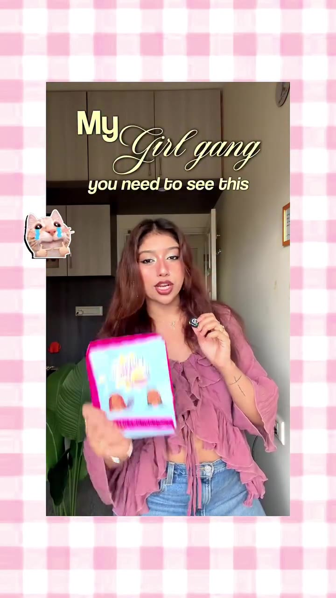
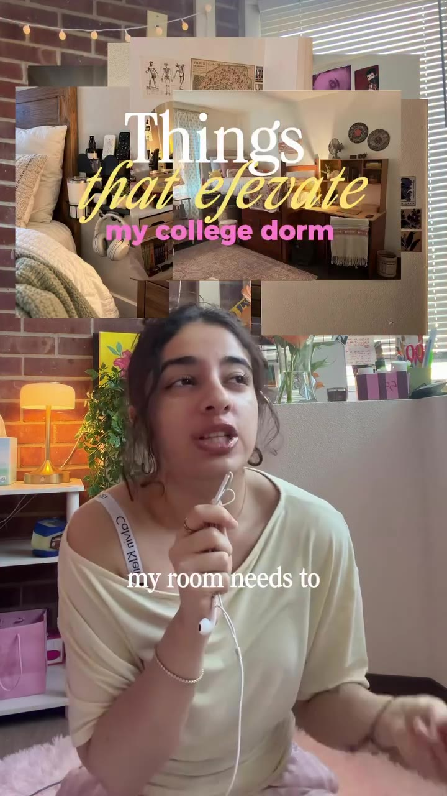
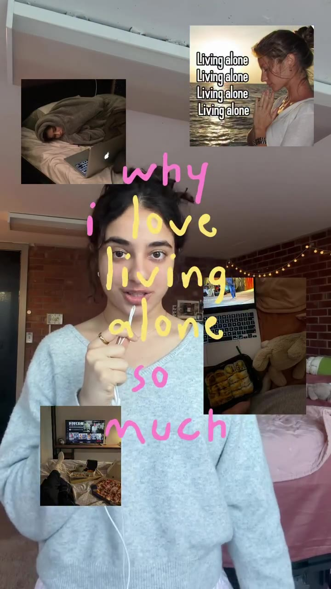
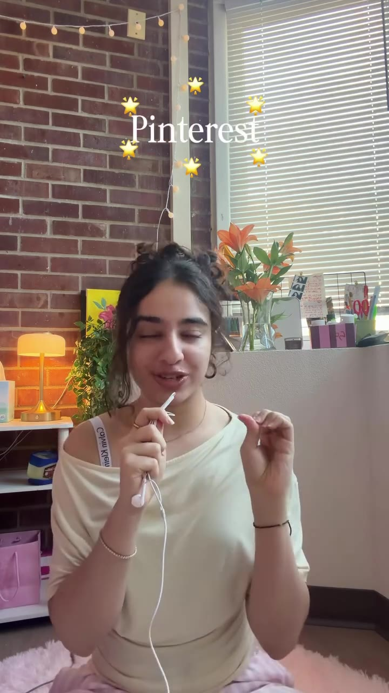
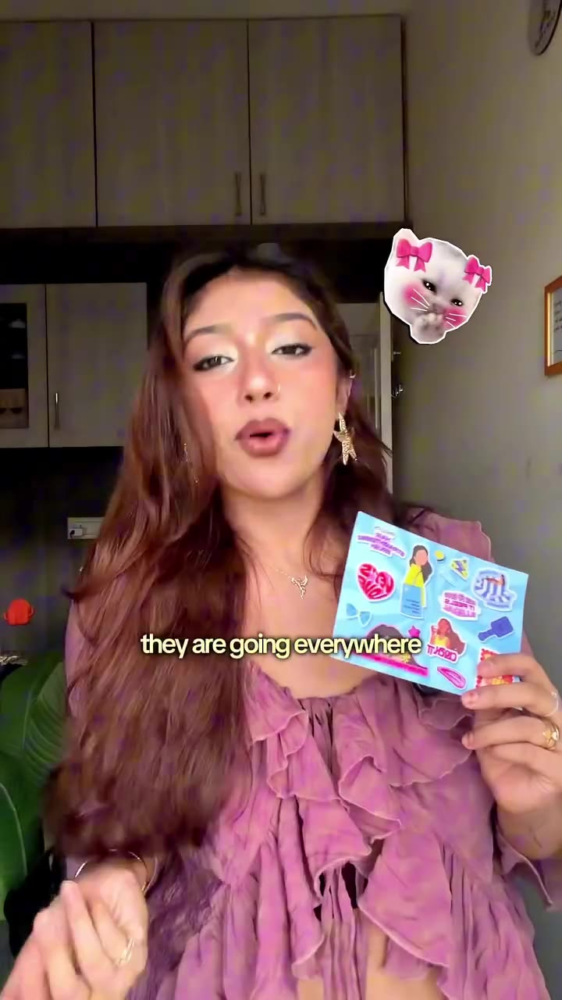
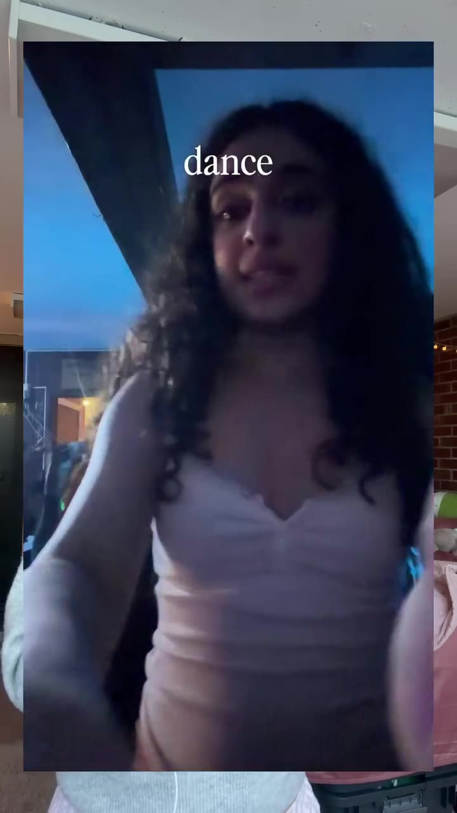
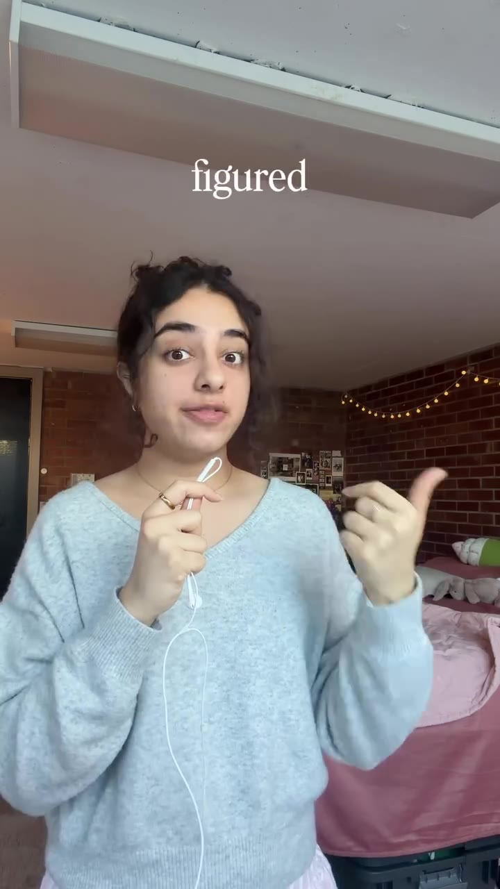

# Style Guide: the "Aesthetic Talking-Head" Reel

A breakdown of 3 reference Reels/Shorts (a creator talking to camera, with photos, stickers and pretty backgrounds layered on top) and a recipe for making new ones. Reference frames are in `reference/aesthetic/`.

| # | Video | Length | Type |
|---|-------|--------|------|
| A | "My Girl gang, you need to see this" (hair-straightener PR kit) | 0:40 | Product unboxing / UGC ad |
| B | "Things that elevate my college dorm" | 0:53 | List / tips |
| C | "why i love living alone so much" | 1:11 | Opinion / storytime |

All three are the same formula: **one person, one take, talking to camera.** The polish comes entirely from the layers added on top.

---

## 1. Technical format

| Spec | Value (measured) |
|------|------------------|
| Aspect / resolution | 9:16, 720×1280 (shoot and export at 1080×1920) |
| Frame rate | 30 fps |
| Length | 40–70 s |
| Loudness | **−14 to −16 LUFS** integrated |
| Silence | **None longer than 0.4 s.** Every pause is cut out (jump cuts). |
| Cuts | A cut or new layer every **1.5–3 s** (A: 20 cuts in 40 s) |
| Audio | The creator's own voice, recorded on **wired earphones with an in-line mic** (visible in B and C), so it sounds close and intimate. Music, if any, sits very low. |

**Golden rule: something on screen changes on almost every phrase.** It might be a caption word, a photo popping in, a sticker, or a jump cut. The face stays, and everything around it moves.

---

## 2. The base footage (what they film)

- **Framing:** waist-up or chest-up, centred, phone on a tripod at eye level. Head sits around the top third, and the area above the head is left clear for captions.
- **Setting is part of the aesthetic:** a styled corner with fairy lights, plants, a warm lamp, a pink or soft bedspread, a brick wall, blinds. Soft daylight from a window. No harsh overhead light.
- **Outfit matches the palette:** mauve/pink top in A, cream in B, baby-blue sweater in C. The clothes are chosen to match the background and graphics.
- **Delivery:** expressive and fast, with lots of hand gestures, wide eyes on the punchline, and a hand to the chest. Holding the earphone mic like a microphone has become part of the look.
- **Jump cuts are part of the style.** Cut out every breath and "um", and alternate the zoom between cuts (100% → 110% → 100%) so the jumps look deliberate.

---

## 3. The background "frame" (the shrinking-video look)

This is the move you asked about (video A). The talking-head clip is shown **smaller, as a card sitting on a patterned background**, instead of filling the screen.



**How it works in the references:**
- **The hook (0–3 s)** is framed on **pink gingham**. The clip is scaled to **~73%** and centred, so there's about 100 px of pattern on the left and right, with a little more space at the top and bottom.
- At ~3 s it **hard-cuts to full screen** for the main talking.
- **B-roll and product close-ups** (12–17 s, 27–29 s) go back into the frame, this time on **candy-pink vertical stripes**, at **~78%** scale.
- So **"framed" means a special moment** (hook, product, detail). Full screen means "I'm talking to you". Switching between the two resets attention.
- The card has square corners and no border or shadow. It's clean and flat.

**The "little by little" version:** to make the video shrink gradually instead of cutting, animate the scale from **100% to 75% over 0.6–1.0 s** with an ease-out (fast at first, then settling). Add a very slow extra push of 75% → 73% across the rest of the shot so it never fully stops moving. Reverse it (75% → 100%) to come back to full screen.

**Background options that fit the look:**
- Pink and white gingham check (cute, girly, product)
- Candy-pink vertical stripes (shopping, beauty)
- Cream and butter-yellow gingham, sage-green check, baby-blue stripes (match these to the outfit)
- A soft blurred and brightened copy of the same clip (the "blur fill" version)

Keep the pattern **pastel and low-contrast.** It should look like wrapping paper, not a flag.

---

## 4. Captions (three layers, each with a different job)

### 4.1 Hook title (first 2–3 s): mixed fonts
The opening line is a **designed title card in 2–3 typefaces**, built up word by word as it's spoken.

| Video | Title | Fonts |
|-------|-------|-------|
| A | **My** / *Girl gang* / you need to see this | Rounded bold sans ("My") + elegant **script** ("Girl gang") + bold italic sans (subline). All in **butter yellow `#F7EFA0`**. |
| B | Things / *that elevate* / my college dorm | Big white **serif** + yellow **script** + small **hot-pink bold sans** `#FF4FB8`. |
| C | why i love living alone so much | **Handwritten marker** font, alternating **pink `#FF7BC4` and yellow `#F5E663`** per line, written in letter by letter (a "write-on" effect). |

 

Formula: **one plain word, one fancy script word, and one small punchy subline.**

### 4.2 Running captions, style 1: one word at a time, big serif (B and C)
- **Only one word on screen at a time** (sometimes two, like "you don't realise"). It changes exactly as the word is spoken.
- Font: an **elegant thin serif**, e.g. *Instrument Serif*, *Playfair Display*, *Cormorant*, or *DM Serif Display*. White, about 44–50 px at 720 wide, with a soft drop shadow so it's readable on any background.
- Position: **fixed, top-centre, about 5% down** (above the head). It never moves.
- In B, the word is surrounded by **5–6 little star emojis ⭐ in a ring**, which makes it look like a sparkle and adds to the cute mood.



### 4.3 Running captions, style 2: small subtitle line (A)
- A short phrase (4–8 words), **small (~18–20 px), white, bold sans** with a thin dark outline, at **chest height in the middle of the frame**.
- It is deliberately small and modest so it doesn't fight with the product and stickers.

### 4.4 Floating keyword labels (A)
When she lists things ("laptop, phone, comb, mirror"), each word **pops in at a different spot around her head** in **italic bold yellow `#F7EFA0`**, and they build up until all four are on screen.

---

## 5. Cut-out stickers and photo cards

### 5.1 Cut-out stickers
- These are **cut-out PNGs** of a meme (the crying cat), a cute character, or an emoji 🎁, with a **thick white outline (~6–8 px) and a soft drop shadow**, so they look like real vinyl stickers.
- Placement: **at the edge of the frame**, near the top corners or the side of the head, and never over the face. They're often **half on the frame and half on the background** pattern.
- Size: about 15–20% of the frame width.
- They show up on emotional beats like "you need to see this", "they are going everywhere" and "like sorry".

**The wiggle** (subtle in the references, so push it a bit for more energy):
- **Pop in:** scale 0 → 115% → 100% over 0.25 s (overshoot), with a small rotation.
- **Idle wiggle:** rotate back and forth **±4–6°** in a loop of about 0.8–1.2 s, plus a slight **up-and-down bob of 4–6 px** and a "breathing" scale of 100 ↔ 104%. Offset each sticker's timing so they don't move together.
- **Pop out:** scale to 0 over 0.15 s, or just cut.
- The CapCut equivalents are "Wobble", "Swing" or "Rock" loop animations, or keyframes.



**Making the cut-outs:** take any photo, remove the background (CapCut "Remove background", Canva BG remover, iOS long-press "Lift subject", or `hyperframes remove-background`), then add a white **stroke** of about 8 px and a soft shadow.

### 5.2 Photo cards (the visual voiceover)
This is how they make the words visual. Whenever the creator mentions something, **a real photo of it pops up as a rectangle over the top half of the frame**, covering the background while her face stays visible below.



- They are rectangular and flat, with square corners and no border, usually **about 45–65% of the frame width**, sitting between the caption and the face.
- They **appear on the exact word** ("fairy lights" shows fairy lights, "mirror" shows the mirror, "parents" shows a dinner photo, "permission" shows a cat meme).
- Each one lasts 1–3 s, then cuts away.
- They're usually personal photos and videos from the camera roll, with memes mixed in for jokes.
- **Pile-up collage:** on a list ("a version of me that... where... daughter... girlfriend...") the photos **stack and overlap at slight angles**, one per beat, until they fill the screen. Then they all disappear at once. This works really well at the emotional peak.
- In the hook (C), small photos sit in the corners around the handwritten title, like a mood-board.



---

## 6. Colour palette

| Use | Colour |
|-----|--------|
| Butter yellow (titles, labels) | `#F7EFA0` |
| Hot pink (accent subline, handwriting) | `#FF4FB8` / `#FF7BC4` |
| Gingham pink | `#F6C6DA` on white |
| Candy stripe | `#F59BC4` / `#FBD3E5` |
| Caption white | `#FFFFFF` + shadow `rgba(0,0,0,.35)` |

Keep everything **warm, pastel and slightly bright.** Grade the footage a bit warm, lift the shadows slightly and add a little softness. Avoid harsh contrast.

---

## 7. Timeline recipe (a 45 s video)

| Time | What's on screen |
|------|------------------|
| 0–3 s | **Hook.** Framed on gingham (or full screen with a corner photo collage). Mixed-font title builds word by word. One cut-out sticker pops in and wiggles. |
| 3–8 s | Full-screen talking head. Captions start (one word or a small line). First photo card on the first concrete noun. |
| 8–35 s | **Main body.** Jump cut every 2–3 s with alternating zoom. A photo card on every concrete noun. Floating keyword labels on lists. 2–3 stickers on emotional beats. Switch to the **framed background for product or detail shots**. |
| ~30–40 s | **Peak.** Photo pile-up collage, or the most emotional line. |
| last 5 s | **CTA** ("comment LINK", "follow for part 2"). Back to the clean full-screen face, holding the product. No graphics except captions. |

---

## 8. Checklist before export

- [ ] No pause longer than 0.4 s, and jump cuts alternate the zoom
- [ ] Hook title uses 2–3 fonts and lands in the first 2 s
- [ ] Captions sit in one fixed position and are timed to the word
- [ ] Every concrete noun gets a photo card on the exact word
- [ ] Stickers have a white outline and shadow, sit away from the face, and wiggle with offset timing
- [ ] Framed-on-pattern shots are used for the hook and product moments only
- [ ] Everything is inside the safe area (top 8% and bottom 20% are clear of UI)
- [ ] −14 LUFS, voice clear, music very low or none

---

## 9. Building it in HyperFrames (code version)

- **Frame shrink:** put the clip in a `.card` over a gingham `background` (CSS `repeating-linear-gradient` in both directions with 50% alpha pink), and tween `scale: 1 → 0.75` with `power3.out` over 0.8 s.
- **Sticker wiggle (GSAP):**
  ```js
  tl.fromTo(s, {scale:0, rotation:-15}, {scale:1, rotation:0, duration:.3, ease:"back.out(2.5)"}, t);
  tl.to(s, {rotation:5, y:-5, duration:.5, ease:"sine.inOut", yoyo:true, repeat:9}, t+.3);
  ```
  Use a fixed `repeat` count, not `-1`, so the render is deterministic.
- **Sticker outline:** `filter: drop-shadow(0 0 0 #fff)` stacked 4×, or bake the white stroke into the PNG (cleaner).
- **One-word captions:** transcribe with `hyperframes transcribe` to get word timestamps, then make one clip per word.
